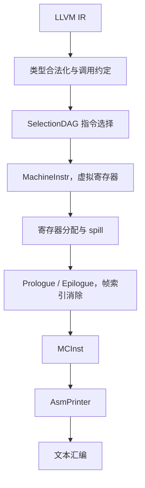

# XAI LLVM 后端 CodeGen

本文描述 XAI 后端如何把 LLVM IR 编成文本汇编。指令语义见 [isa.md](isa.md)。构建命令见 [README.md](../README.md)。

XAI 是教学用目标，架构名 `xai`。LLVM 的 OS 类型里已经占用了 `aix`，因此本目标使用独立的架构枚举 `Triple::xai`。输入是 LLVM IR，输出是文本汇编。没有硬件、模拟器、汇编器或目标文件编码器。

源码按 LLVM 树内路径放在仓库的 `llvm/`。上游提交记在 `patches/llvm-project.rev`。`scripts/setup_llvm.sh` 从该提交导出没有 `.git` 的树，按 `patches/series` 打补丁，再把 `llvm/` 复制上去。`llc` 在 `third_party/llvm-project/build/bin/llc`。

## 1. 流水线

AI 后端和 CPU 后端共用 LLVM CodeGen。目标之间的差别在寄存器类、合法类型、调用约定、指令选择和汇编打印。XAI 只替换这些描述，调度、寄存器分配、prolog/epilog 使用 LLVM 的默认 pass。



`XAITargetMachine` 继承 `CodeGenTargetMachineImpl`。`XAIPassConfig::addInstSelector` 挂上 `XAIDAGToDAGISel`。默认 CPU 是 `generic`，重定位模型是 static，代码模型是 Small。`TargetLoweringObjectFileELF` 只为创建汇编流而存在。

Data layout：

```
e-m:e-p:64:64-i64:64-i32:32-i16:16-i8:8-f64:64-f32:32-f16:16-n64-S8192
```

小端，ELF 名称修饰，指针 64 位，原生整数宽度 64 位。`S8192` 表示栈按 8192 bit（1024 字节）对齐，与矩阵 spill 槽一致。同一条字符串也写在 `TargetDataLayout.cpp` 的 `xai` 分支里。

`llc -mtriple=xai` 能选中这个后端，依赖四处对上游已有文件的修改，记在 `patches/0001-register-xai-architecture.patch`。上游没有的目标、intrinsic 和测试记在 `patches/0002-add-xai-backend.patch`。允许改动的路径都在 `patches/upstream-files.txt` 里，新增路径以 `+` 开头：

| 位置 | 作用 |
|---|---|
| `Triple.h` / `Triple.cpp` | 架构名 `xai`，64 位指针，小端 |
| `TargetDataLayout.cpp` | 上面的 data layout |
| `llvm/CMakeLists.txt` | `LLVM_ALL_TARGETS` 加入 `XAI` |
| `Intrinsics.td` 与 `include/llvm/IR/CMakeLists.txt` | 包含 `IntrinsicsXAI.td`，生成 `IntrinsicsXAI.h` |

`patches/series` 必须能干净地应用到 `patches/llvm-project.rev`。`scripts/update_llvm_patch.sh` 用干净上游和当前树的差异重写 `0001`，用本仓库的 `llvm/` 重写 `0002`，并拒绝清单以外的源码改动。

`lib/Target/CMakeLists.txt` 按 `LLVM_TARGETS_TO_BUILD` 添加子目录，因此目标目录本身不必再手写 `add_subdirectory`。

## 2. 寄存器、指令与调用约定

### 2.1 寄存器

| 类 | 寄存器 | 机器类型 | 分配宽度 |
|---|---|---|---|
| `GPR` | `r0`–`r31` | `i64` | 8 字节，对齐 8 字节 |
| `MR` | `m0`–`m7` | `v256f32`、`v256f16` | 1024 字节，对齐 1024 字节 |

`r31` 在 `getReservedRegs` 里保留，分配器不会把它分给虚拟寄存器。它是栈指针。`getFrameRegister` 返回 `r31`。`XAIGenRegisterInfo` 的返回地址寄存器号是 `r30`；本目标没有 call，也没有链接寄存器，`r30` 仍是可分配的 GPR。

`MR` 同时容纳两种 tile。16×16 FP32 是 1024 字节，16×16 FP16 是 512 字节。两种值占用同一组物理寄存器，spill 槽按较大的 1024 字节计算。TableGen 里 alignment 的单位是 bit，所以写成 8192，并设置 `Size = 8192`。

没有被调用者保存寄存器。`getCalleeSavedRegs` 返回空表。

### 2.2 指令

| 汇编 | 机器操作码 | 作用 |
|---|---|---|
| `xai.mma md, ma, mb, mc` | `XAI_MMA` | `md = ma × mb + mc`。`ma`、`mb` 为 FP16 tile，`mc`、`md` 为 FP32 tile |
| `xai.mload.f16 md, imm(rs)` | `XAI_MLOAD_F16` | 从指针读 FP16 tile |
| `xai.mload.f32 md, imm(rs)` | `XAI_MLOAD_F32` | 从指针读 FP32 tile |
| `xai.mstore.f16 imm(rs), ma` | `XAI_MSTORE_F16` | 写 FP16 tile |
| `xai.mstore.f32 imm(rs), ma` | `XAI_MSTORE_F32` | 写 FP32 tile |
| `xai.ld rd, imm(rs)` | `XAI_LD` | GPR load，用于 GPR spill |
| `xai.st imm(rs), rs` | `XAI_ST` | GPR store，用于 GPR spill |
| `xai.mov rd, rs` | `XAI_MOV` | GPR 拷贝 |
| `xai.mmov md, ms` | `XAI_MMOV` | 矩阵寄存器拷贝 |
| `xai.add rd, rs1, rs2` | `XAI_ADD` | 寄存器加 |
| `xai.addi rd, rs, imm` | `XAI_ADDI` | 加有符号 32 位立即数 |
| `xai.li rd, imm` | `XAI_LI` | 物化有符号 32 位常量 |
| `xai.br label` | `XAI_BR` | 无条件跳转 |
| `xai.beq rs1, rs2, label` | `XAI_BEQ` | 相等则跳转 |
| `xai.bne rs1, rs2, label` | `XAI_BNE` | 不等则跳转 |
| `xai.bltu rs1, rs2, label` | `XAI_BLTU` | 无符号小于则跳转 |
| `xai.bgeu rs1, rs2, label` | `XAI_BGEU` | 无符号大于等于则跳转 |
| `xai.ret` | `XAI_RET` | 返回 |

`xai.mma` 是四操作数指令：结果写入 `md`，`mc` 保持原值。寄存器分配可以把 `md` 和某个源操作数合并到同一个物理寄存器，汇编里因此可能出现 `xai.mma m0, m0, m1, m2`。合并发生在分配阶段，指令语义不变。

### 2.3 调用约定

`CC_XAI` 把 `i64` 依次放入 `r0`–`r7`。指针在上述 data layout 下也是 `i64`。第 9 个及以后的 `i64` 在 TableGen 里写成 8 字节栈槽，`LowerFormalArguments` 遇到栈上传参会报错。变参报错。返回值只接受 `void`；非 void 返回报错。

矩阵值不作为参数或返回值。kernel 接收指向 tile 的指针，用 `llvm.xai.mload.*` 装入 `MR`，用 `llvm.xai.mstore.*` 写回。

## 3. 各阶段

### 3.1 LLVM IR 与类型

`IntrinsicsXAI.td` 的 `TargetPrefix` 是 `xai`。记录名 `int_xai_mma` 在 IR 里是 `@llvm.xai.mma`。

| Intrinsic | 参数与结果 | 内存效果 |
|---|---|---|
| `llvm.xai.mload.f16` | `ptr` → `<256 x half>` | 读内存，带 chain |
| `llvm.xai.mload.f32` | `ptr` → `<256 x float>` | 读内存，带 chain |
| `llvm.xai.mstore.f16` | `ptr`，`<256 x half>` | 写内存 |
| `llvm.xai.mstore.f32` | `ptr`，`<256 x float>` | 写内存 |
| `llvm.xai.mma` | 两个 `<256 x half>`、一个 `<256 x float>` → `<256 x float>` | `IntrNoMem` |

`<256 x half>` 对应 `MVT::v256f16`，`<256 x float>` 对应 `MVT::v256f32`。这两种 MVT 来自 LLVM 23 的 `ValueTypes.td`。

`XAITargetLowering` 把 `i64` 放进 `GPR`，把两种 tile 向量放进 `MR`，然后调用 `computeRegisterProperties`。这三种类型因此是合法类型，legalizer 不会把 tile 拆成标量。布尔内容是 `ZeroOrOneBooleanContent`。`TargetLowering` 给出的 `setcc` 结果类型是指针宽度 `i64`。条件分支在构建 DAG 时先产生 `i1` 的 `setcc`，类型合法化再把它提升到 `i64`。

合法类型只表示该值可以放进寄存器。tile 向量的普通 `add`、普通 `load`/`store`，以及 `float` 标量运算，没有选择模式。

### 3.2 参数与返回值

`LowerFormalArguments` 用 `CC_XAI` 分析参数。寄存器参数通过 `addLiveIn` 进入 `GPR`，再 `getCopyFromReg` 交给 DAG。三个指针参数因此成为 `r0`、`r1`、`r2` 的 live-in。

`LowerReturn` 在返回值为空时生成 `XAIISD::RET_FLAG`。该节点带 chain，由 `XAI_RET` 的 pattern 选成 `xai.ret`。

### 3.3 指令选择

选择器是 `XAIDAGToDAGISel`。`Select` 先处理 tile 访存 intrinsic，其余节点交给 TableGen 生成的 `SelectCode`。

| DAG | 选择结果 | 实现位置 |
|---|---|---|
| `llvm.xai.mma`（`INTRINSIC_WO_CHAIN`） | `XAI_MMA` | `XAIInstrInfo.td` 的 `Pat` |
| `llvm.xai.mload.f16/f32`（`INTRINSIC_W_CHAIN`） | `XAI_MLOAD_F16/F32`，偏移 0 | `selectMemIntrinsic` |
| `llvm.xai.mstore.f16/f32`（`INTRINSIC_VOID`） | `XAI_MSTORE_F16/F32`，偏移 0 | `selectMemIntrinsic` |
| `add`，两操作数均为 GPR | `XAI_ADD` | `Pat` |
| `add`，一操作数为有符号 32 位立即数 | `XAI_ADDI` | `Pat`，立即数谓词 `XAISimm32` |
| 有符号 32 位常量 | `XAI_LI` | `Pat` |
| `br` | `XAI_BR` | 指令自身的 pattern |
| `brcond` + `setcc` | `XAI_BEQ` / `XAI_BNE` / `XAI_BLTU` / `XAI_BGEU` | `LowerBR_CC` |

带 chain 的 load/store intrinsic 在 TableGen 里带未建模副作用，`Pat` 匹配不上，所以在 C++ 里选择。偏移立即数固定为 0；指针算术在 load 之前用 `xai.add` 或 `xai.addi` 完成。

`getelementptr i8` 在 `shouldPreservePtrArith` 关闭时降成 `ISD::ADD`，与整数加法共用模式。元素大小为 1 的常量偏移，只要落在有符号 32 位以内，就选 `xai.addi`。更大的元素类型会先生成 `shl` 或 `mul`，这两条运算没有选择模式。

条件分支的路径如下。

1. `CondBr` 在 SelectionDAGBuilder 里变成 `SETCC` 与 `BRCOND`，假分支再接一条 `BR`。
2. `ISD::BRCOND` 的动作是 Expand。操作数是 `SETCC` 且比较类型为 `i64` 时，展开为 `ISD::BR_CC`。
3. `ISD::BR_CC` 对 `i64` 是 Custom。`LowerBR_CC` 按条件码生成一条比较跳转，chain 放在机器节点操作数的最后。

| 条件码 | 指令 |
|---|---|
| `SETEQ` | `xai.beq` |
| `SETNE` | `xai.bne` |
| `SETULT` | `xai.bltu` |
| `SETUGE` | `xai.bgeu` |

块布局会把落在下一块上的真分支取反，所以 `icmp ult` 经常变成跳出循环的 `xai.bgeu`。`analyzeBranch` 删掉紧接着跳到下一块的 `xai.br`。分支折叠随后把循环头和回边合成条件跳转：入口用 `xai.bgeu` 判断是否跳过循环，循环体末尾用 `xai.bltu` 回到自身。其他条件码在 `LowerBR_CC` 里报错。

### 3.4 寄存器分配、spill 与栈帧

分配器是 LLVM 自带的。目标提供的是它调用的钩子。

| 钩子 | 行为 |
|---|---|
| `copyPhysReg` | GPR 用 `xai.mov`，MR 用 `xai.mmov` |
| `analyzeBranch` / `insertBranch` / `removeBranch` | 识别条件分支和 `xai.br`，删掉跳到下一块的无条件分支 |
| `isCopyInstrImpl` | 识别这两条拷贝，供合并使用 |
| `storeRegToStackSlot` / `loadRegFromStackSlot` | GPR 用 `xai.st` / `xai.ld`；MR 用 `xai.mstore.f32` / `xai.mload.f32` |
| `eliminateFrameIndex` | 见下文 |
| `emitPrologue` / `emitEpilogue` | 栈大小非 0 时用 `xai.addi` 调整 `r31` |

帧向下增长，对齐 1024 字节，局部区域偏移为 0，没有 frame pointer。栈大小为 0 时 prologue 和 epilogue 都不插入指令。

spill 槽在分配期间是帧索引。`eliminateFrameIndex` 把该操作数改成 `r31`，并把下一条立即数设为：

```
objectOffset + stackSize + 原立即数 + SPAdj
```

向下增长时，对象偏移为负，加上栈大小后成为相对最终 `r31` 的非负位移。prologue 在此之前已经执行 `xai.addi r31, r31, -stackSize`。epilogue 在第一个 terminator 之前执行相反的 `xai.addi`。

`mma.ll` 的矩阵值个数不超过 8，汇编里没有栈调整。`spill.ll` 把 9 个 MMA 结果放进循环 phi，使它们在回边上同时存活。单条指令最多读三个矩阵寄存器，活值个数仍然超过 `m0`–`m7`，因此至少有一个 MR 进入 1024 字节栈槽。对应汇编包含：

- `xai.addi r31, r31, -N`，`N` 为 1024 的倍数
- `xai.mstore.f32 imm(r31), m*`
- `xai.mload.f32 m*, imm(r31)`
- 返回前的 `xai.addi r31, r31, N`

FP16 tile 若被 spill，使用的仍是 FP32 宽度的 `xai.mstore.f32` / `xai.mload.f32`。`xai.li` 标了 `isReMaterializable` 和 `isAsCheapAsAMove`，有符号 32 位常量在寄存器不够时可以重新物化。

调度使用 `Sched::RegPressure` 和 `NoItineraries`。默认调度 pass 会运行，指令没有延迟或发射模型。

### 3.5 MC 与汇编打印

`XAIAsmPrinter::emitInstruction` 跳过 meta 指令，调用 `lowerXAIMachineInstrToMCInst`，再 `EmitToStreamer`。可降下的操作数是寄存器、立即数和基本块。基本块变成 `MCSymbolRefExpr`，指向该块的 `MCSymbol`。`XAIInstPrinter::printOperand` 打印寄存器名、十进制立即数，以及 `MCAsmInfo::printExpr` 产生的标号（形如 `LBB0_1`）。

汇编字符串来自 TableGen。`xai.mma $dst, $a, $b, $acc` 在物理寄存器确定后打印为 `xai.mma m0, m0, m1, m2` 这类形式。

文本汇编的流在创建时需要 `MCAsmBackend`。`XAIAsmBackend` 是小端实现：`applyFixup` 不写修复，`writeNopData` 写 0。`createObjectTargetWriter` 返回一个 ELF writer，重定位类型在 `getRelocType` 里报错。没有注册 `MCCodeEmitter`，因此 `llc -filetype=obj` 在创建编码器时失败。

## 4. 三条编译结果

FileCheck 约束助记符和栈访问形态。除 spill 测试里的 `r31` 外，物理寄存器号由分配器决定，下面的编号是当前 `llc` 的一次输出。

### 4.1 直线性 MMA

`llvm/test/CodeGen/XAI/mma.ll` 把三个指针上的 tile 装入矩阵寄存器，做一次乘加，再把 FP32 结果写回第三个指针。

```
kernel:
	xai.mload.f16 m0, 0(r0)
	xai.mload.f16 m1, 0(r1)
	xai.mload.f32 m2, 0(r2)
	xai.mma m0, m0, m1, m2
	xai.mstore.f32 0(r2), m0
	xai.ret
```

这条函数的栈大小为 0，没有 prologue。`m0` 同时出现在目的和 `ma` 上，是寄存器合并的结果。

### 4.2 计数循环

`loop.ll` 的参数是三个 tile 指针、无符号上界 `n` 和步长 `step`。循环变量从 0 开始，每个迭代用 `getelementptr i8` 把 A、B 指针前进 512 字节，把 C 指针前进 1024 字节，再用寄存器步长更新下标。

```
loop:
	xai.li r5, 0
	xai.bgeu r5, r3, LBB0_3
LBB0_2:
	xai.mload.f16 m0, 0(r0)
	xai.mload.f16 m1, 0(r1)
	xai.mload.f32 m2, 0(r2)
	xai.mma m0, m0, m1, m2
	xai.mstore.f32 0(r2), m0
	xai.add r5, r5, r4
	xai.addi r2, r2, 1024
	xai.addi r1, r1, 512
	xai.addi r0, r0, 512
	xai.bltu r5, r3, LBB0_2
LBB0_3:
	xai.ret
```

`r5` 是下标，初值由 `xai.li` 写成 0；`r3` 是上界 `n`，`r4` 是步长。`xai.add` 把步长加进下标，`xai.addi` 做指针步进。入口的 `xai.bgeu` 在下标已经不小于上界时直接跳到 `xai.ret`。循环体末尾的 `xai.bltu` 只在更新后的下标仍小于上界时回到 `LBB0_2`；条件不成立时不跳转，顺序落到紧接着的 `xai.ret`。跳到紧邻下一块的 `xai.br` 已被删掉。

### 4.3 矩阵寄存器 spill

`spill.ll` 计算 9 个相互依赖的 MMA 结果，并把它们作为循环 phi 传入循环体。循环体按迭代变化的地址逐个 store。9 个 `MR` 活值同时存在，物理寄存器只有 8 个。

汇编中的栈形态是：

```
xai.addi r31, r31, -2048
xai.mstore.f32 1024(r31), m1
xai.mload.f32 m1, 1024(r31)
xai.addi r31, r31, 2048
xai.ret
```

`-2048` 表示两个 1024 字节槽。具体 spill 个数和偏移随分配结果变化；测试要求的是对 `r31` 的负向调整、`xai.mstore.f32` / `xai.mload.f32` 访问 `(r31)`，以及返回前的正向调整。

## 5. 文件索引

| 文件 | CodeGen 职责 |
|---|---|
| `llvm/include/llvm/IR/IntrinsicsXAI.td` | intrinsic 名称、类型、内存效果 |
| `llvm/lib/Target/XAI/XAI.td` | 目标、汇编打印、`generic` 处理器 |
| `XAIRegisterInfo.td` | GPR、MR、编码与 DWARF 号 |
| `XAICallingConv.td` | `CC_XAI` |
| `XAIInstrInfo.td` | 指令、`Pat`、分支操作数 `brtarget` |
| `XAITargetMachine.cpp` | data layout、pass config、目标注册 |
| `XAIISelLowering.cpp` | 合法类型、参数、返回、`BR_CC` |
| `XAIISelDAGToDAG.cpp` | tile load/store 的自定义选择 |
| `XAIInstrInfo.cpp` | 拷贝、spill、reload、分支折叠 |
| `XAIRegisterInfo.cpp` | 保留寄存器、帧索引消除 |
| `XAIFrameLowering.cpp` | `r31` 的 prologue / epilogue |
| `XAIAsmPrinter.cpp` | `MachineInstr` 到流 |
| `XAIMCInstLower.cpp` | 寄存器、立即数、基本块到 `MCInst` |
| `MCTargetDesc/XAIInstPrinter.cpp` | 汇编文本 |
| `MCTargetDesc/XAIMCTargetDesc.cpp` | 注册 MC 组件；无 `MCCodeEmitter` |
| `MCTargetDesc/XAIAsmBackend.cpp` | 供文本汇编使用的空后端 |
| `TargetInfo/XAITargetInfo.cpp` | `RegisterTarget<Triple::xai>` |
| `llvm/test/CodeGen/XAI/*.ll` | `llc -mtriple=xai -verify-machineinstrs` |

TableGen 生成 `XAIGenDAGISel.inc`、`XAIGenInstrInfo.inc`、`XAIGenRegisterInfo.inc`、`XAIGenCallingConv.inc`、`XAIGenAsmWriter.inc`、`XAIGenSubtargetInfo.inc`。CMake 不生成汇编匹配器、反汇编器或指令编码器。

## 6. 支持范围

下列 IR 可以通过本后端，并在 `-verify-machineinstrs` 下得到文本汇编：

- `void` 函数，参数是不超过 8 个的 `ptr` 或 `i64`
- 五条 `llvm.xai.*` intrinsic
- `i64` 的 `add`，以及有符号 32 位立即数加法和常量
- `getelementptr i8` 的常量字节偏移，偏移落在有符号 32 位以内
- `icmp eq`、`icmp ne`、`icmp ult` 与对应的条件分支，以及无条件 `br`

下列输入会在编译期失败：

| 输入 | 失败点 |
|---|---|
| 超过 8 个 `i64`/`ptr` 参数、变参、非 `void` 返回 | `LowerFormalArguments` / `LowerReturn` 报错 |
| 有符号比较，以及其他未列出的条件码 | `LowerBR_CC` 报错 |
| `call`、`select`、乘、除、移位 | 指令选择无法选择 |
| tile 的普通算术、普通 load/store | 指令选择无法选择 |
| 超出有符号 32 位的整数常量 | `xai.li` / `xai.addi` 的模式不匹配 |
| `llc -filetype=obj` | 缺少 `MCCodeEmitter` |

后端不包含这些组件：汇编解析器、反汇编器、指令行程、GlobalISel、Clang builtin、MLIR dialect，以及把汇编执行或与参考 GEMM 对数值的运行时。
