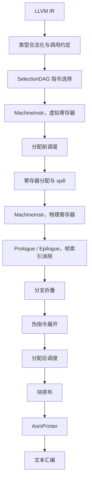
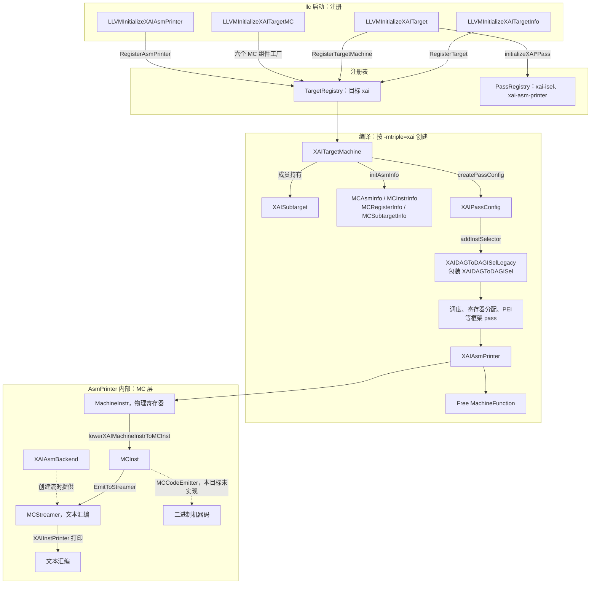

# XAI LLVM 后端 CodeGen

本文描述 XAI 后端如何把 LLVM IR 编成文本汇编。指令语义见 [isa.md](isa.md)。构建命令见 [README.md](../README.md)。

XAI 是教学用目标，架构名 `xai`。LLVM 的 OS 类型里已经占用了 `aix`，因此本目标使用独立的架构枚举 `Triple::xai`。输入是 LLVM IR，输出是文本汇编。没有硬件、模拟器、汇编器或目标文件编码器。

新增源码按 LLVM 树内路径放在仓库的 `llvm/`，由 `patches/0002-add-xai-backend.patch` 打进构建树。setup 只应用 `patches/series`，不另做目录复制。上游提交记在 `patches/llvm-project.rev`。构建树是 `third_party/llvm-project`，没有 `.git`。`llc` 在 `third_party/llvm-project/build/bin/llc`。

## 1. 流水线

XAI 与通用 CPU 后端共用 LLVM CodeGen。LLVM 提供合法化驱动、SelectionDAG 选择框架、BranchFolder、寄存器分配、MachineScheduler、PEI 和汇编流。目标提供这些框架要调用的描述和钩子：寄存器类、合法类型、调用约定、DAG lowering、指令模式、调度模型、分配与栈帧钩子、MC 打印。`Sched::RegPressure` 只影响 SelectionDAG 在指令选择期间的发射顺序，不影响后面的 MachineScheduler。MachineInstr 的调度有两次，用的都是 `XAISchedule.td` 里的顺序发射模型：一次在寄存器分配前，一次在 PEI、分支折叠和伪指令展开之后。PEI 是 LLVM 的 pass，插入的 prologue 和 epilogue 指令来自 `XAIFrameLowering`。下图只画主要阶段，寄存器合并、尾复制和拷贝传播等 pass 没有单独列出。`-O0` 下只跑伪指令展开，不跑分支折叠和块排布。



图里有两份 `MachineInstr`。指令选择出来的用虚拟寄存器；寄存器分配换成物理寄存器。PEI 之后的各步改的都是这份物理寄存器指令：分支折叠删掉跳到下一块的跳转，伪指令展开把剩下的 `COPY` 换成 `xai.mov` / `xai.mmov`，块排布重排基本块并整理循环回边。AsmPrinter 打印块排布之后的结果。

| 阶段 | LLVM 负责 | 本仓库中的实现 |
|---|---|---|
| 目标注册 | `TargetRegistry`，按 triple 选择 `TargetMachine` | 四个 `LLVMInitializeXAI*` 函数，见 1.1 |
| 类型合法化 | 按合法类型拆分或提升非法类型 | `XAIISelLowering.cpp` 登记 `i64`、`v256f16`、`v256f32` |
| 调用约定 | `CCState` 按 TableGen 规则分配位置 | `XAICallingConv.td` 的 `CC_XAI`，C++ 拒绝栈参数和非 `void` 返回 |
| 指令选择 | SelectionDAG 匹配 `Pat`，Custom 节点调用 `LowerOperation` | `XAIInstrInfo.td`；访存和 `BR_CC` 在 C++ 中完成 |
| 分配前调度 | `MachineScheduler`，`-O0` 不跑 | `XAISchedule.td` 的 `XAIModel`；`enableMachineScheduler` 返回 true |
| 分配后调度 | `PostMachineScheduler`，`-O0` 不跑 | 同一模型；`substitutePass` 替换旧的 `PostRAScheduler`，见 3.4 |
| 分支折叠与块排布 | `BranchFolder`（PEI 之后）和 `MachineBlockPlacement`（分配后调度之后）调用 `analyzeBranch` 等钩子，`-O0` 不跑 | `XAIInstrInfo.cpp` 的四个分支钩子，见 3.3 |
| 伪指令展开 | `ExpandPostRAPseudos` 在分配后调度之前展开 `COPY` 等通用伪指令；源和目的是同一个寄存器的拷贝直接删除 | `XAIInstrInfo::copyPhysReg`，见 3.5 和 4.3 |
| 寄存器分配 | 分配虚拟寄存器，必要时插入 spill | `copyPhysReg`，以及 `xai.st` / `xai.ld`、`xai.mstore.f32` / `xai.mload.f32` |
| 栈帧 | PEI 调用 prologue、epilogue 和帧索引消除 | `XAIFrameLowering.cpp`、`XAIRegisterInfo::eliminateFrameIndex` |
| 汇编打印 | AsmPrinter 把 `MachineInstr` 降成 `MCInst`，送到 MC 流 | `XAIAsmPrinter.cpp`、`XAIMCInstLower.cpp`、`XAIInstPrinter.cpp` |

Data layout：

```
e-m:e-p:64:64-i64:64-i32:32-i16:16-i8:8-f64:64-f32:32-f16:16-n64-S8192
```

小端，ELF 名称修饰，指针 64 位，原生整数宽度 64 位。`S8192` 表示栈按 8192 bit（1024 字节）对齐，与矩阵 spill 槽一致。同一条字符串也写在 `TargetDataLayout.cpp` 的 `xai` 分支里。

`llc -mtriple=xai` 能选中这个后端，依赖四处对上游已有文件的修改，记在 `patches/0001-register-xai-architecture.patch`。上游没有的目标、intrinsic 和测试记在 `patches/0002-add-xai-backend.patch`。允许改动的路径都在 `patches/upstream-files.txt` 里，新增路径以 `+` 开头：

| 位置 | 作用 |
|---|---|
| `Triple.h` / `Triple.cpp` | 架构名 `xai`，64 位指针，小端 |
| `TargetDataLayout.cpp` | 上面的 data layout |
| `llvm/CMakeLists.txt` | `LLVM_ALL_TARGETS` 加入 `XAI` |
| `Intrinsics.td` 与 `include/llvm/IR/CMakeLists.txt` | 包含 `IntrinsicsXAI.td`，生成 `IntrinsicsXAI.h` |

`patches/series` 必须能干净地应用到 `patches/llvm-project.rev`。`scripts/update_llvm_patch.sh` 用干净上游和当前树的差异重写 `0001`，用本仓库的 `llvm/` 重写 `0002`，并拒绝清单以外的源码改动。

`lib/Target/CMakeLists.txt` 按 `LLVM_TARGETS_TO_BUILD` 添加子目录，因此目标目录本身不必再手写 `add_subdirectory`。

### 1.1 目标注册与组件关系

`llc` 启动时依次调用 `InitializeAllTargets()`、`InitializeAllTargetMCs()`、`InitializeAllAsmPrinters()`。其中 `InitializeAllTargets()` 先调用各目标的 `TargetInfo` 初始化函数，再调用 `Target` 初始化函数。对 XAI，这三步一共调用四个函数：

| 函数 | 文件 | 登记到 | 登记内容 | 何时取用 |
|---|---|---|---|---|
| `LLVMInitializeXAITargetInfo` | `TargetInfo/XAITargetInfo.cpp` | `TargetRegistry` | `Target` 对象，名字 `xai`，匹配 `Triple::xai` | `-mtriple=xai` 查找目标 |
| `LLVMInitializeXAITarget` | `XAITargetMachine.cpp` | `TargetRegistry`、`PassRegistry` | `XAITargetMachine` 的工厂；`xai-isel`、`xai-asm-printer` 两个 pass 名 | 创建 `TargetMachine`；`-print-after`、`-stop-after` 等按名字查找 pass |
| `LLVMInitializeXAITargetMC` | `MCTargetDesc/XAIMCTargetDesc.cpp` | `TargetRegistry` | `MCAsmInfo`、`MCInstrInfo`、`MCRegisterInfo`、`MCSubtargetInfo`、`MCInstPrinter`、`MCAsmBackend` 六个工厂 | 前四个由 `XAITargetMachine` 构造时的 `initAsmInfo` 取用；后两个在创建汇编流时取用 |
| `LLVMInitializeXAIAsmPrinter` | `XAIAsmPrinter.cpp` | `TargetRegistry` | `XAIAsmPrinter` 的工厂 | `addPassesToEmitFile` 创建 `AsmPrinter` pass |

两张注册表作用不同。`TargetRegistry` 按目标保存工厂函数，用来创建 `TargetMachine`、MC 组件和 `AsmPrinter`。`PassRegistry` 保存 pass 的 ID、命令行名和构造方式，用来按名字查找 pass。`initializeXAIAsmPrinterPass` 和 `initializeXAIDAGToDAGISelLegacyPass` 由各自 `.cpp` 中的 `INITIALIZE_PASS` 宏生成，只登记名字，不决定 pass 在流水线中的位置。



注册顺序不决定 pass 的先后。一次编译怎么把这些组件串起来，见 1.2。

### 1.2 一次编译的顺序

`llc -mtriple=xai` 按下面的顺序进行。

1. 启动时调用 1.1 的四个函数，把工厂和 pass 名写入注册表。这一步只做一次。
2. 按 triple 创建 `XAITargetMachine`（继承 `CodeGenTargetMachineImpl`）。没有 `-mcpu` 时 CPU 名是 `generic`，没指定时重定位模型是 static、代码模型是 Small。构造函数同时创建成员 `XAISubtarget`，里面有 `XAIInstrInfo`、`XAIFrameLowering`、`XAITargetLowering`，并按这个 CPU 名找到 `XAIModel`。它还创建一个 ELF 的 `TargetLoweringObjectFile`，AsmPrinter 用它决定段怎么写。接着 `initAsmInfo` 从 `TargetRegistry` 取出 `MCRegisterInfo`、`MCInstrInfo`、`MCSubtargetInfo` 和 `MCAsmInfo`。
3. `CodeGenTargetMachineImpl::addPassesToEmitFile` 搭建流水线，分三步，与上面的注册顺序无关：
   - `addPassesToGenerateCode` 调用 `createPassConfig`，得到 `XAIPassConfig`。它的构造函数用 `substitutePass` 替换分配后调度用的 pass，原因见 3.4。框架按默认序列加 pass；加到指令选择时回调 `addInstSelector`，加入 `createXAIISelDag` 返回的 `XAIDAGToDAGISelLegacy`。
   - `addAsmPrinter` 从 `TargetRegistry` 取出 `XAIAsmPrinter` 的工厂，创建 pass 并加在代码生成 pass 之后。所以它是最后一个生成代码的 pass。
   - 最后加入 `Free MachineFunction`，释放每个函数的 `MachineFunction`。`llc -debug-pass=Structure` 的末尾就是 `XAI Assembly Printer`、`Free MachineFunction`。
4. 对每个函数跑这条流水线。轮到指令选择时，pass 管理器调用 `XAIDAGToDAGISelLegacy`，它把每个 DAG 节点交给内部的 `XAIDAGToDAGISel::Select`。之后的 pass 通过 `MF.getSubtarget()` 取得同一个 `XAISubtarget`，再取出寄存器、指令、栈帧和调度模型。
5. `XAIAsmPrinter` 把每条 `MachineInstr` 降成 `MCInst` 并打印成文本汇编，见 3.6。

`-O0` 不加入两次 MachineInstr 调度，以及分支折叠等后期优化。`-stop-after` 截断流水线时，`addPassesToEmitFile` 改为加入 MIR 打印 pass，不再创建 `AsmPrinter`。

## 2. 寄存器、指令与调用约定

### 2.1 寄存器

| 类 | 寄存器 | 机器类型 | 溢出槽 |
|---|---|---|---|
| `GPR` | `r0`–`r31` | `i64` | 8 字节，对齐 8 字节 |
| `MR` | `m0`–`m7` | `v256f32`、`v256f16` | 1024 字节，对齐 1024 字节 |

`r31` 在 `getReservedRegs` 里保留，分配器不会把它分给虚拟寄存器。它是栈指针。`getFrameRegister` 返回 `r31`。`XAIGenRegisterInfo` 的返回地址寄存器号是 `r30`；本目标没有 call，也没有链接寄存器，`r30` 仍是可分配的 GPR。

`MR` 同时容纳两种 tile。16×16 FP32 是 1024 字节，16×16 FP16 是 512 字节。两种值占用同一组物理寄存器，spill 槽按较大的 1024 字节计算。TableGen 里 alignment 的单位是 bit，所以写成 8192，并设置 `Size = 8192`。

没有被调用者保存寄存器。`getCalleeSavedRegs` 返回空表。

### 2.2 指令

| 汇编 | 机器操作码 | 作用 |
|---|---|---|
| `xai.mma md, ma, mb, mc` | `XAI_MMA` | `md = ma × mb + mc`。`ma`、`mb` 为 FP16 tile，`mc`、`md` 为 FP32 tile |
| `xai.mload.f16 md, imm(rs)` | `XAI_MLOAD_F16` | 从指针读 FP16 tile |
| `xai.mload.f32 md, imm(rs)` | `XAI_MLOAD_F32` | 从指针读 FP32 tile |
| `xai.mstore.f16 imm(rs), ma` | `XAI_MSTORE_F16` | 写 FP16 tile |
| `xai.mstore.f32 imm(rs), ma` | `XAI_MSTORE_F32` | 写 FP32 tile |
| `xai.ld rd, imm(rs)` | `XAI_LD` | GPR load，用于 GPR spill |
| `xai.st imm(rs), rs` | `XAI_ST` | GPR store，用于 GPR spill |
| `xai.mov rd, rs` | `XAI_MOV` | GPR 拷贝 |
| `xai.mmov md, ms` | `XAI_MMOV` | 矩阵寄存器拷贝 |
| `xai.add rd, rs1, rs2` | `XAI_ADD` | 寄存器加 |
| `xai.addi rd, rs, imm` | `XAI_ADDI` | 加有符号 32 位立即数 |
| `xai.li rd, imm` | `XAI_LI` | 物化有符号 32 位常量 |
| `xai.br label` | `XAI_BR` | 无条件跳转 |
| `xai.beq rs1, rs2, label` | `XAI_BEQ` | 相等则跳转 |
| `xai.bne rs1, rs2, label` | `XAI_BNE` | 不等则跳转 |
| `xai.bltu rs1, rs2, label` | `XAI_BLTU` | 无符号小于则跳转 |
| `xai.bgeu rs1, rs2, label` | `XAI_BGEU` | 无符号大于等于则跳转 |
| `xai.ret` | `XAI_RET` | 返回 |

`xai.mma` 是四操作数指令：结果写入 `md`，`mc` 保持原值。寄存器分配可以把 `md` 和某个源操作数合并到同一个物理寄存器，汇编里因此可能出现 `xai.mma m0, m0, m1, m2`。合并发生在分配阶段，指令语义不变。

### 2.3 调用约定

`CC_XAI` 把 `i64` 依次放入 `r0`–`r7`。指针在上述 data layout 下也是 `i64`。第 9 个及以后的 `i64` 在 TableGen 里写成 8 字节栈槽，`LowerFormalArguments` 遇到栈上传参会报错。变参报错。返回值只接受 `void`；非 void 返回报错。

矩阵值不作为参数或返回值。kernel 接收指向 tile 的指针，用 `llvm.xai.mload.*` 装入 `MR`，用 `llvm.xai.mstore.*` 写回。

## 3. 各阶段

### 3.1 LLVM IR 与类型

`IntrinsicsXAI.td` 的 `TargetPrefix` 是 `xai`。记录名 `int_xai_mma` 在 IR 里是 `@llvm.xai.mma`。

| Intrinsic | 参数与结果 | 内存效果 |
|---|---|---|
| `llvm.xai.mload.f16` | `ptr` → `<256 x half>` | 读内存，带 chain |
| `llvm.xai.mload.f32` | `ptr` → `<256 x float>` | 读内存，带 chain |
| `llvm.xai.mstore.f16` | `ptr`，`<256 x half>` | 写内存 |
| `llvm.xai.mstore.f32` | `ptr`，`<256 x float>` | 写内存 |
| `llvm.xai.mma` | 两个 `<256 x half>`、一个 `<256 x float>` → `<256 x float>` | `IntrNoMem` |

`<256 x half>` 对应 `MVT::v256f16`，`<256 x float>` 对应 `MVT::v256f32`。这两种 MVT 来自 LLVM 23 的 `ValueTypes.td`。

`XAITargetLowering` 把 `i64` 放进 `GPR`，把两种 tile 向量放进 `MR`，然后调用 `computeRegisterProperties`。这三种类型因此是合法类型，legalizer 不会把 tile 拆成标量。布尔内容是 `ZeroOrOneBooleanContent`。`TargetLowering` 给出的 `setcc` 结果类型是指针宽度 `i64`。条件分支在构建 DAG 时先产生 `i1` 的 `setcc`，类型合法化再把它提升到 `i64`。

合法类型只表示该值可以放进寄存器。tile 向量的普通 `add`、普通 `load`/`store`，以及 `float` 标量运算，没有选择模式。

### 3.2 参数与返回值

`LowerFormalArguments` 用 `CC_XAI` 分析参数。寄存器参数通过 `addLiveIn` 进入 `GPR`，再 `getCopyFromReg` 交给 DAG。例如三个指针参数成为 `r0`、`r1`、`r2` 的 live-in。

`LowerReturn` 在返回值为空时生成 `XAIISD::RET_FLAG`。该节点带 chain，由 `XAI_RET` 的 pattern 选成 `xai.ret`。

### 3.3 指令选择

`llvm.xai.*` 在合法化阶段保持为通用 intrinsic 节点，不生成 `XAIISD` 节点，也不生成 `MachineInstr`。构建 DAG 时，`IntrNoMem` 的 `llvm.xai.mma` 成为 `ISD::INTRINSIC_WO_CHAIN`，读内存的 `mload` 成为 `ISD::INTRINSIC_W_CHAIN`，写内存的 `mstore` 成为 `ISD::INTRINSIC_VOID`。节点上带的是 intrinsic ID。`v256f16` 和 `v256f32` 已登记为合法类型，合法化不拆开这些节点。`LowerOperation` 只处理 `ISD::BR_CC`。本目标唯一的 target-specific DAG 节点是 `LowerReturn` 生成的 `XAIISD::RET_FLAG`。

选择逻辑和 pass 包装是两个类。`XAIDAGToDAGISel` 继承 `SelectionDAGISel`，只负责选择，不实现 pass 接口。`XAIDAGToDAGISelLegacy` 继承 `SelectionDAGISelLegacy`，是旧 pass 管理器里的 `FunctionPass`：它持有一个 `XAIDAGToDAGISel`，被调用时把工作转过去。LLVM 这样拆，是为了让同一套选择逻辑适配新旧两种 pass 管理器；新 pass 管理器对应的包装是 `SelectionDAGISelPass`。XAI 只写了旧包装，`llc` 默认走这条路径。`createXAIISelDag` 返回的是 `XAIDAGToDAGISelLegacy`。`INITIALIZE_PASS` 登记的名字 `xai-isel` 也属于这个包装类，见 1.1。

`Select` 先处理 tile 访存 intrinsic，其余节点交给 TableGen 生成的 `SelectCode`。`llvm.xai.mma` 由 `XAIInstrInfo.td` 的 `Pat` 选成 `XAI_MMA`。四条访存 intrinsic 带 chain，TableGen 的 `Pat` 匹配不上，由 `selectMemIntrinsic` 在 C++ 里选成对应的 `MachineInstr`。

| DAG | 选择结果 | 实现位置 |
|---|---|---|
| `llvm.xai.mma`（`INTRINSIC_WO_CHAIN`） | `XAI_MMA` | `XAIInstrInfo.td` 的 `Pat` |
| `llvm.xai.mload.f16/f32`（`INTRINSIC_W_CHAIN`） | `XAI_MLOAD_F16/F32`，偏移 0 | `selectMemIntrinsic` |
| `llvm.xai.mstore.f16/f32`（`INTRINSIC_VOID`） | `XAI_MSTORE_F16/F32`，偏移 0 | `selectMemIntrinsic` |
| `add`，两操作数均为 GPR | `XAI_ADD` | `Pat` |
| `add`，一操作数为有符号 32 位立即数 | `XAI_ADDI` | `Pat`，立即数谓词 `XAISimm32` |
| 有符号 32 位常量 | `XAI_LI` | `Pat` |
| `br` | `XAI_BR` | 指令自身的 pattern |
| `brcond` + `setcc`，DAGCombiner 合成 `br_cc` | `XAI_BEQ` / `XAI_BNE` / `XAI_BLTU` / `XAI_BGEU` | 合法化时由 `LowerBR_CC` 生成，见下面的比较跳转 |

带 chain 的 load/store intrinsic 在 TableGen 里带未建模副作用，`Pat` 匹配不上，所以在 C++ 里选择。偏移立即数固定为 0；指针算术在 load 之前用 `xai.add` 或 `xai.addi` 完成，见下面的地址步进。

#### 地址步进

`loop.ll` 每轮用 `getelementptr i8, ptr %ap, i64 512` 让指针前进。`shouldPreservePtrArith` 默认返回 false，XAI 没有重写，所以 SelectionDAGBuilder 把它降成普通的 `ISD::ADD`，和整数加法共用 `XAIInstrInfo.td` 里的模式：

```
def XAISimm32 : PatLeaf<(imm), [{ return isInt<32>(N->getSExtValue()); }]>;
def : Pat<(add GPR:$rs1, GPR:$rs2), (XAI_ADD GPR:$rs1, GPR:$rs2)>;
def : Pat<(add GPR:$rs, XAISimm32:$imm), (XAI_ADDI GPR:$rs, XAISimm32:$imm)>;
def : Pat<(i64 XAISimm32:$imm), (XAI_LI XAISimm32:$imm)>;
```

`XAISimm32` 只接受有符号 32 位以内的常量。步长 512 和 1024 满足条件，选成 `xai.addi`；下标的步长 `%step` 在寄存器里，选成 `xai.add`；下标初值 0 选成 `xai.li`。只有元素大小为 1 时，GEP 的下标才直接是字节偏移。更大的元素类型会先生成 `shl` 或 `mul`，这两条运算没有选择模式。`XAI_ADDI` 标了 `isAsCheapAsAMove`，通用 pass 把它看作和拷贝一样便宜。

#### 比较跳转

XAI 没有标志寄存器，比较和跳转是同一条指令，例如 `xai.bgeu rs1, rs2, target`：`rs1 >= rs2`（无符号）就跳。LLVM IR 和 SelectionDAG 里，比较和跳转一开始是分开的，这一节说明它们怎么合成一条 XAI 指令。

先说清楚涉及的几个名字：

| 名字 | 所在层 | 含义 |
|---|---|---|
| `CondBrInst` | LLVM IR | 条件分支 `br i1 %c, label %T, label %F`。LLVM 23 把原来的 `BranchInst` 拆成 `UncondBrInst` 和 `CondBrInst`，SelectionDAGBuilder 用 `visitCondBr` 处理后者 |
| `ISD::SETCC` | SelectionDAG 通用节点 | 比较两个值，结果是布尔值。操作数为 `lhs, rhs, 条件码` |
| 条件码 `ISD::CondCode` | SelectionDAG | `SETEQ`、`SETNE`、`SETULT`、`SETUGE` 等。`U` 表示无符号比较 |
| `ISD::BRCOND` | SelectionDAG 通用节点 | 按一个布尔值跳转。操作数为 `chain, cond, 目标块` |
| `ISD::BR` | SelectionDAG 通用节点 | 无条件跳转。操作数为 `chain, 目标块` |
| `ISD::BR_CC` | SelectionDAG 通用节点 | 比较和跳转合成一个节点。操作数为 `chain, 条件码, lhs, rhs, 目标块` |
| `XAI_BEQ` / `XAI_BNE` / `XAI_BLTU` / `XAI_BGEU` | XAI 机器节点 | XAI 的比较跳转指令，定义在 `XAIInstrInfo.td` |
| `LowerBR_CC` | XAI 的 C++ 函数 | 把一个 `BR_CC` 换成对应的 XAI 比较跳转 |

**chain 是什么。** SelectionDAG 是一张图，不是指令列表，节点之间本身没有先后顺序。普通运算靠数据边排序：`mma` 用到 load 的结果，就必须排在 load 后面。但读写内存和跳转这类有副作用的操作，彼此之间往往没有数据依赖：先 store 再跳转，跳转并不读 store 的结果。如果没有别的约束，它们可能被排反。chain 就是专门为它们加的顺序边：

- chain 是一种特殊的值，类型是 `MVT::Other`，DAG 打印里写作 `ch`。
- 有副作用的节点把一个 chain 当作第一个操作数，表示“在它之后执行”；同时再输出一个新的 chain，交给下一个有副作用的节点。
- 每个基本块的 DAG 从 `EntryToken`（`t0`）开始，它是这条链的起点。
- 多条链要汇合时，用 `TokenFactor` 合成一个 chain，表示“这些都完成之后”。

`loop.ll` 的 body 块在构建 DAG 时是：

```
t0: ch,glue = EntryToken
t4: v256f16,ch = llvm.xai.mload.f16 t0, ..., t3        // 第 1 个 load，接在 t0 后面
t7: v256f16,ch = llvm.xai.mload.f16 t4:1, ..., t6      // 第 2 个 load，接在 t4 输出的 chain 后面
t11: v256f32,ch = llvm.xai.mload.f32 t7:1, ..., t10    // 第 3 个 load
t13: v256f32 = llvm.xai.mma ..., t4, t7, t11            // 没有副作用，不在链上，只靠数据边
t15: ch = llvm.xai.mstore.f32 t11:1, ..., t10, t13     // store 接在第 3 个 load 后面
t19 / t22 / t26 / t33: ch = CopyToReg t0, ...          // 写回下一轮要用的指针和下标
t35: ch = TokenFactor t19, t22, t26, t33, t15          // 等这些都完成
t36: ch = br t35, BasicBlock:ch<header>                // 跳转排在最后
```

`t4:1` 表示节点 `t4` 的第 2 个输出，也就是它输出的 chain。所以 `brcond` 的操作数 `chain, cond, 目标块` 的意思是：等 chain 代表的副作用都完成，按布尔值 `cond` 决定是否跳到目标块。header 里的 `t12: ch = br t10, ...` 把 `brcond`（`t10`）的输出 chain 作为输入，保证条件跳转排在无条件跳转之前。

注意，基本块操作数 `BasicBlock:ch<exit>` 的类型也打印成 `ch`，也就是 `MVT::Other`，但它只是一个跳转目标，不是 chain。

**XAI 写了什么。** 只有 `XAIISelLowering.cpp` 里的两行设置和两个函数：

```cpp
setOperationAction(ISD::BRCOND, MVT::Other, Expand);
setOperationAction(ISD::BR_CC, MVT::i64, Custom);
```

`setOperationAction(节点, 类型, 动作)` 告诉 LLVM：这种节点在这个类型上，XAI 能不能直接选择。默认动作是 Legal，表示指令选择能直接匹配。Expand 表示交给 LLVM，把它改写成别的通用节点。Custom 表示由目标自己的 `LowerOperation` 处理。XAI 的 `LowerOperation` 只处理 `ISD::BR_CC`，交给 `LowerBR_CC`：

```cpp
switch (CC) {
case ISD::SETEQ:  Opc = XAI::XAI_BEQ;  break;
case ISD::SETNE:  Opc = XAI::XAI_BNE;  break;
case ISD::SETULT: Opc = XAI::XAI_BLTU; break;
case ISD::SETUGE: Opc = XAI::XAI_BGEU; break;
default: report_fatal_error("XAI does not support this branch condition");
}
return SDValue(DAG.getMachineNode(Opc, SDLoc(Op), MVT::Other,
                                  {LHS, RHS, Dest, Chain}), 0);
```

它直接返回机器节点，而不是先生成一个 `XAIISD` 节点、再写 `Pat` 去匹配。基本块的类型也是 `MVT::Other`，指令发射器只把最后一个 `Other` 操作数当作 chain，所以操作数顺序是比较的两端、目标块，最后才是 chain。

**`loop.ll` 的 header 在每一步的 DAG。** 下面是 `llc -mtriple=xai -debug-only=isel` 打出的真实结果，`t2` 是下标 `%i`，`t4` 是上界 `%n`。这个选项需要带断言的 LLVM 构建。

1. **构建 DAG。** `visitCondBr` 发现 `icmp` 和 `br` 在同一块，且比较结果只被这条跳转使用，就把比较折进分支，生成 `setcc`，再交给 `visitSwitchCase` 生成跳转。条件为真的目标 body 正好是下一块，`visitSwitchCase` 把真假目标对调，并用 `xor cond, -1` 把条件取反。另一个目标总会再接一条 `br`，即使它就是下一块：源码注释说明，这样做是为了方便后面需要取反条件的 DAG 优化。

   ```
   t6: i1 = setcc t2, t4, setult:ch
   t8: i1 = xor t6, Constant:i1<-1>                       // 取反：i >= n
   t10: ch = brcond t0, t8, BasicBlock:ch<exit>           // 成立就跳 exit
   t12: ch = br t10, BasicBlock:ch<body>                  // 否则跳 body
   ```

2. **DAGCombiner 合并。** 这一步在合法化之前。`visitBRCOND` 先把 `xor (setcc ult), -1` 重写成 `setcc uge`，再把 `brcond (setcc ...)` 合成一个 `br_cc`。合成的前提是 `TLI.isOperationLegalOrCustom(ISD::BR_CC, i64)` 为真，XAI 把 `BR_CC` 设成 Custom，正好满足。也就是说，`BR_CC` 的 Custom 在这里第一次起作用。

   ```
   t16: ch = br_cc t0, setuge:ch, t2, t4, BasicBlock:ch<exit>
   t12: ch = br t16, BasicBlock:ch<body>
   ```

3. **合法化。** `LegalizeDAG` 对每个节点查动作。`br_cc` 先查条件码 `setuge` 在 `i64` 上是否合法（默认合法），再查 `BR_CC` 在 `i64` 上的动作，得到 Custom，于是调用 `XAITargetLowering::LowerOperation`，最终进入 `LowerBR_CC`。`-debug-only=legalizedag` 的日志是：

   ```
   Legalizing: t16: ch = br_cc t0, setuge:ch, t2, t4, BasicBlock:ch<exit>
   Trying custom legalization
   Successfully custom legalized node
    ... replacing: t16: ch = br_cc t0, setuge:ch, t2, t4, BasicBlock:ch<exit>
        with:      t17: ch = XAI_BGEU t2, t4, BasicBlock:ch<exit>, t0
   ```

4. **指令选择。** `XAI_BGEU` 已经是机器节点，`Select` 不再处理。剩下的 `br` 由 `XAI_BR` 的模式 `[(br bb:$dst)]` 选中。

   ```
   t17: ch = XAI_BGEU t2, t4, BasicBlock:ch<exit>, t0
   t12: ch = XAI_BR BasicBlock:ch<body>, t17
   ```

`-O0` 走的是同一条路径：DAGCombiner 在 `-O0` 下也会做这次合并。

**`BRCOND` 的 Expand 是兜底。** 上面的路径里，`brcond` 在合法化之前就被合并掉了，没有走到 Expand。只有当某个 `brcond` 的条件不是 `setcc`、DAGCombiner 又没法改写时，它才会留到合法化。合法化查到 `BRCOND` 的动作是 Expand，就调用 LLVM 自带的 `SelectionDAGLegalize::ExpandNode`，XAI 不写代码：

```cpp
case ISD::BRCOND:
  Tmp1 = Node->getOperand(0);                    // chain
  Tmp2 = Node->getOperand(1);                    // cond
  if (Tmp2.getOpcode() == ISD::SETCC &&
      TLI.isOperationLegalOrCustom(ISD::BR_CC, Tmp2.getOperand(0).getValueType())) {
    // brcond chain, (setcc lhs, rhs, cc), dest  =>  br_cc chain, cc, lhs, rhs, dest
    Tmp1 = DAG.getNode(ISD::BR_CC, dl, MVT::Other, Tmp1, Tmp2.getOperand(2),
                       Tmp2.getOperand(0), Tmp2.getOperand(1), Node->getOperand(2));
  } else {
    // brcond chain, cond, dest  =>  br_cc chain, setne, (and cond, 1), 0, dest
    Tmp3 = DAG.getNode(ISD::AND, dl, Tmp2.getValueType(), Tmp2,
                       DAG.getConstant(1, dl, Tmp2.getValueType()));
    Tmp1 = DAG.getNode(ISD::BR_CC, dl, MVT::Other, Tmp1,
                       DAG.getCondCode(ISD::SETNE), Tmp3,
                       DAG.getConstant(0, dl, Tmp3.getValueType()), Node->getOperand(2));
  }
```

源码在 `LegalizeDAG.cpp` 的 `case ISD::BRCOND`，上面省略了条件已经是 `undef` 或 `and x, 1` 时不再加 `and` 的分支。展开之后的处理分三步：

1. `brcond` 被替换成新生成的 `br_cc`。条件是 `setcc` 时，直接取出它的两端和条件码；否则只看布尔值的最低位，变成“`cond & 1 != 0` 就跳”。
2. 合法化会反复扫描整张图，直到没有未处理的节点。新的 `br_cc` 在下一轮被扫到，查到 `BR_CC` 在 `i64` 上是 Custom，于是和主路径一样进入 `LowerBR_CC`，变成 `XAI_BEQ` / `XAI_BNE` / `XAI_BLTU` / `XAI_BGEU`。
3. 第二种情况生成的 `and` 也要被合法化和选择。XAI 没有 `and` 的选择模式，所以这条路径目前会在指令选择时报 `Cannot select`。

如果 `BRCOND` 保留默认的 Legal，合法化不会改它，它会一直留到指令选择，而 XAI 没有匹配 `brcond` 的模式，同样会报 `Cannot select`。现有测试的条件都来自 `icmp`，DAGCombiner 总能先把它们合成 `br_cc`，不会走到这条兜底路径。

`LowerBR_CC` 只认四种条件码：

| 条件码 | 指令 |
|---|---|
| `SETEQ` | `xai.beq` |
| `SETNE` | `xai.bne` |
| `SETULT` | `xai.bltu` |
| `SETUGE` | `xai.bgeu` |

有符号比较、`SETUGT`、`SETULE` 等其他条件码直接报错，本目标没有用交换操作数的方法把它们换成这四种。条件如果不是来自 `icmp`，例如 `trunc i64 to i1`，类型合法化会生成 `and`，而 XAI 没有 `and` 的选择模式，也会报 `Cannot select`。

指令选择结束时，`loop.ll` 的循环是：

```
bb.1.header:
  XAI_BGEU %0:gpr, %11:gpr, %bb.3      // i >= n 跳到 exit
  XAI_BR %bb.2                         // 否则跳到 body
bb.2.body:
  ...
  XAI_BR %bb.1                         // 回到 header
```

每轮要执行三条跳转。后面两步由 LLVM 的通用 pass 完成，把它减到一条。

#### 分支分析钩子

`BranchFolder` 和 `MachineBlockPlacement` 不认识 XAI 的跳转指令。它们通过 `XAIInstrInfo` 的四个钩子读懂和改写基本块结尾：

| 钩子 | 作用 |
|---|---|
| `analyzeBranch` | 从块尾往前识别最多两条跳转，给出条件跳转的目标 `TBB`、另一个目标 `FBB` 和条件 `Cond`。`Cond` 编码为 `[opcode, rs1, rs2]`。遇到 `xai.ret` 这类不认识的结尾返回 true，通用 pass 就不改这个块。`AllowModify` 为真时，顺手删除跳到下一块的 `xai.br` |
| `removeBranch` | 删除块尾的所有跳转，按每条 4 字节报告删掉的长度 |
| `insertBranch` | 按 `Cond` 重新生成条件跳转；有 `FBB` 时再加一条 `xai.br` |
| `reverseBranchCondition` | 取反条件：`beq` ↔ `bne`，`bltu` ↔ `bgeu` |

不实现这些钩子时，`analyzeBranch` 的默认实现返回“看不懂”，两个 pass 都不会动 XAI 的跳转。

#### 删除跳到下一块的跳转

PEI 之后、分配后调度之前，`BranchFolder` 对每个块调用 `analyzeBranch`。header 的 `FBB` 是 body，而 body 在布局上紧接着 header，所以只保留 `XAI_BGEU`，删掉 `XAI_BR %bb.2`。

#### 循环回边

分配后调度之后，`MachineBlockPlacement` 重新排布基本块。header 只剩一条比较跳转，复制它的代价很小，所以这个 pass 在 `-O2` 下做尾复制：把 header 复制进它的两个前驱，然后删掉 header。

```
bb.0.entry:
  ...
  XAI_BGEU $r5, $r3, %bb.3             // 复制进入口：第一次进入前判断
bb.2.body:
  ...
  XAI_BLTU $r5, $r3, %bb.2             // 复制进循环尾：条件取反后跳回 body
bb.3.exit:
  XAI_RET
```

复制进 body 尾部时，原来的语义是 `i >= n` 跳到 exit，否则回 body。exit 被排在 body 后面，于是 pass 调用 `reverseBranchCondition`，把 `BGEU` 改成 `BLTU`：`i < n` 跳回 body，否则顺序落到 exit。原来回 header 的 `XAI_BR %bb.1` 也不再需要。最后每轮只执行回边上的一条 `xai.bltu`。

`-O0` 不跑这两个 pass。汇编里保留 header，每个跳到下一块的地方都有一条 `xai.br`，每轮执行三条跳转。

### 3.4 指令调度

XAI 不写调度算法。分配前的 pass 是 `MachineScheduler`，分配后的 pass 是 `PostMachineScheduler`。两个 pass 都自己建依赖图：用 `XAIModel` 给每条边标延迟，再算出每条指令的最早发射周期，然后重排基本块里的指令。重排时 pass 调用一个策略对象，由它决定新的顺序。XAI 没有更换策略，所以分配前用默认的 `GenericScheduler`，分配后用默认的 `PostGenericScheduler`。策略不再计算边的延迟，只使用依赖图里已经算好的发射周期。

`XAIModel` 是顺序、单发射模型（`IssueWidth = 1`，`MicroOpBufferSize = 0`），只有一条流水线 `XAIPipe`。`CompleteModel = 1`，所以每条指令，包括 `COPY`，都要有 `InstRW`。延迟是相对代价，不是实测周期：GPR 运算、移动、立即数、GPR 访存和分支是 1，矩阵 load 和 `xai.mma` 是 4，矩阵 store 是 2。

依赖图里一个节点是一条指令。后一条读前一条写出的寄存器时，连一条数据依赖边，延迟等于生产者在 `XAIModel` 里的延迟，也就是结果写完后要过多久才能被读。`xai.mload.f32` 到 `xai.mma` 的边是 4。`xai.mstore` 不写寄存器，它的 2 不会变成这种边；和其他指令之间只有内存顺序约束，框架给 store 之后的 load 用固定延迟 1，不查 `XAIModel`。XAI 没有 `ReadAdvance`。一条指令的最早发射周期，是它所有前驱的“发射周期加边延迟”里的最大值。`IssueWidth = 1` 再限制每个周期只能发射一条。

寄存器压力是某一时刻还要占着物理寄存器的值有多少。一个虚拟寄存器从定义活到最后一次使用，这整段都算一个。GPR 同时能放下 `r0`–`r30` 共 31 个，MR 是 `m0`–`m7` 共 8 个。某一类同时活着的值多于这个数，多出来的值到寄存器分配时就只能 spill 到栈上。压力就是这个同时存活的个数离上限有多近。`GenericScheduler` 不把值写到栈上，它只通过重排尽量不让个数超过上限。真的超过时，后面的寄存器分配才插入 spill：调用 `storeRegToStackSlot` / `loadRegFromStackSlot`，生成带帧索引的 `xai.mstore.f32` / `xai.mload.f32`。PEI 再给这些槽算偏移，并在函数入口和返回前调整 `r31`，见 3.5。`spill.ll` 让 9 个矩阵值同时存活，迫使至少一次 spill；`sched.ll` 没有超过上限，没有栈调整。

`GenericScheduler` 重排时先看这一步会不会加重压力。把一个值的定义提前、使用留在后面，它活得更久，中间同时活着的值就更多。所以会让某一类超过上限的指令往后放，把定义挪到靠近使用的地方，缩短存活区间。没有超过上限，再把处在更长依赖链上的指令往前放。`sched.ll` 里，`MachineScheduler` 只把 `%3 = COPY $r3` 挪到靠近 `XAI_ADDI` 的位置，`%3` 不必活过前面的矩阵运算，GPR 的同时存活数下降。它没有把 `XAI_ADDI` 提到 `XAI_MMA` 前面：那样加法的结果要一直活到后面的使用，压力反而升高，load 的等待就填不上。

`PostGenericScheduler` 不再看这份额。到了 `PostMachineScheduler`，寄存器已经是物理寄存器，spill 也已经插入。重排时，它只把依赖和物理寄存器复用都允许、并且最早发射周期已经到了的指令往前放，等待更少的更靠前。同一段代码里，`xai.addi` 写入的物理寄存器当时已经没有人再读，就把它提到 `xai.mma` 前面，填上 load 的 4 周期等待。`-O0` 两个 pass 都不跑，加法仍留在 store 之后。

| | 分配前 `MachineScheduler` | 分配后 `PostMachineScheduler` |
|---|---|---|
| 位置 | 寄存器合并之后、分配之前 | PEI、分支折叠和 `ExpandPostRAPseudos` 之后，块排布之前 |
| 看到的寄存器 | 虚拟寄存器 | 已经分配好的物理寄存器 |
| 重排策略 | `GenericScheduler`：先避免存活数超过物理寄存器个数，再用已算好的发射周期 | `PostGenericScheduler`：不再管存活数，只用已算好的发射周期 |
| 额外约束 | 数据依赖和内存依赖 | 同一个物理寄存器被重复使用时，写不能越过尚未读完的旧值 |

两次调度在默认流水线里已经各有一个槽位，打开的方式不同。

分配前的槽位就是 `MachineScheduler`。优化级别不是 `-O0` 时，框架在寄存器合并之后加入它。它真正重排指令还要求 `enableMachineScheduler()` 返回 true，XAI 在 `XAISubtarget` 里这样实现。`-O0` 走快速寄存器分配，这个 pass 不会加入。

分配后的槽位默认放的是旧的 `PostRAScheduler`。它按指令行程（itinerary）调度，不读 `XAIModel` 里的 `InstRW`。XAI 没有 itinerary，延迟都写在 `XAIModel` 里，所以这个槽位要换成和分配前同一套实现的 `PostMachineScheduler`。

`substitutePass` 是 `TargetPassConfig` 提供的方法，XAI 没有重写。`XAIPassConfig` 的构造函数在优化级别不是 `-O0` 时调用 `substitutePass(&PostRASchedulerID, &PostMachineSchedulerID)`。它只在一张表里登记一条替换：以后框架执行 `addPass(PostRAScheduler)` 时，实际加入 `PostMachineScheduler`。槽位仍在 PEI、分支折叠和伪指令展开之后，替换不改变这个位置。`-O0` 时框架本来就不会加入这个槽位。

换上的 pass 还会再查一次开关。`enablePostRAMachineScheduler()` 的默认实现是 `enableMachineScheduler()` 并且调度模型的 `PostRAScheduler` 位为 1。XAI 两处都打开了，`XAISchedule.td` 里 `let PostRAScheduler = 1`。只替换 pass、不打开这一位，pass 会加入流水线但立刻返回，不做重排。反过来，只打开这一位、不调用 `substitutePass`，跑的仍是不读 `XAIModel` 的旧调度器。

本目标不插入 `nop`，也不做冒险识别。调度只改变顺序；硬件被假定会在结果未就绪时自行停顿，所以 `-O0` 的结果仍然正确。

### 3.5 寄存器分配、spill 与栈帧

分配器是 LLVM 自带的。目标提供的是它调用的钩子。

| 钩子 | 行为 |
|---|---|
| `copyPhysReg` | GPR 用 `xai.mov`，MR 用 `xai.mmov` |
| `isCopyInstrImpl` | 识别这两条拷贝，供合并使用 |
| `storeRegToStackSlot` / `loadRegFromStackSlot` | GPR 用 `xai.st` / `xai.ld`；MR 用 `xai.mstore.f32` / `xai.mload.f32` |
| `eliminateFrameIndex` | 见下文 |
| `emitPrologue` / `emitEpilogue` | 栈大小非 0 时用 `xai.addi` 调整 `r31` |

帧向下增长，栈对齐 1024 字节，局部区域偏移为 0，没有 frame pointer，也不能在运行时重新对齐（`StackRealignable=false`）。函数代码的对齐是另一件事：`XAITargetLowering` 用 `setMinFunctionAlignment` 把它设为 4 字节。`setStackPointerRegisterToSaveRestore(r31)` 把 `r31` 交给 PEI。四个分支钩子由 `BranchFolder` 和 `MachineBlockPlacement` 调用，见 3.3，不属于分配器。

栈帧大小由 PEI 的 `calculateFrameObjectOffsets` 计算，`emitPrologue` 和 `emitEpilogue` 只读取结果。它以进入函数时的 SP 为原点，按每个栈对象自己的大小和对齐往后排；对齐取整多出来的字节就是空隙，最后再按 1024 字节向上取整，得到 `StackSize`。这两个函数在 `StackSize` 为 0 时不插指令，否则分别插入 `xai.addi r31, r31, -StackSize` 和返回前的相反调整。入口 SP 按 1024 对齐是 ABI 假设，所以对象离原点的距离按它对齐，就等于地址按它对齐，不需要 frame pointer。

溢出槽的大小和对齐来自寄存器类，不是来自上面的栈对齐值。`GPR` 是 8 字节、8 对齐，`MR` 是 1024 字节、1024 对齐。两种槽排在一起时，各自按自己的对齐取整。因为栈不能重新对齐，对象要求的对齐超过 1024 时会被截到 1024；XAI 把栈对齐设成 1024，就是为了让矩阵槽不被截小。XAI 的栈帧目前只有溢出槽和这些对齐填充：没有 `alloca`，栈上传参会报错，也没有被调用者保存寄存器。

spill 槽在分配期间是帧索引。`eliminateFrameIndex` 在 prologue 已经插入之后，把该操作数改成 `r31`，并把下一条立即数设为：

```
objectOffset + stackSize + 原立即数 + SPAdj
```

向下增长时，对象偏移为负，加上栈大小后成为相对调整后的 `r31` 的非负位移。epilogue 插在第一个 terminator 之前。

`mma.ll` 的矩阵值个数不超过 8，汇编里没有栈调整。`spill.ll` 把 9 个 MMA 结果放进循环 phi，使它们在回边上同时存活。单条指令最多读三个矩阵寄存器，活值个数仍然超过 `m0`–`m7`，因此至少有一个 MR 进入 1024 字节栈槽。当前分配结果是两个，从分配器插入 spill 到 PEI 换成 `r31` 偏移的每一步，见 4.3。FP16 tile 若被 spill，使用的仍是 FP32 宽度的 `xai.mstore.f32` / `xai.mload.f32`。`xai.li` 标了 `isReMaterializable` 和 `isAsCheapAsAMove`，有符号 32 位常量在寄存器不够时可以重新物化。

### 3.6 MC 与汇编打印

`XAIAsmPrinter` 是最后一个生成代码的 pass，位置见 1.2。它把每条 `MachineInstr` 降成 `MCInst`，再交给 MC 层输出。`MCInst` 既不是汇编文本，也不是二进制机器码，而是这两种输出共同的输入。MC 组件从哪里注册，见 1.1。

| 表示 | 所在层 | 内容 |
|---|---|---|
| `MachineInstr` | CodeGen | 操作码、显式与隐式操作数、`killed` / `dead` 等寄存器标记、所属基本块、内存操作数 |
| `MCInst` | MC | 操作码和显式操作数。操作数只有寄存器、立即数、表达式三类 |
| 文本汇编 | 输出 | `XAIInstPrinter` 按 TableGen 的汇编字符串打印 `MCInst` |
| 二进制机器码 | 输出 | `MCCodeEmitter` 把 `MCInst` 编码成字节；本目标未实现 |

`XAIAsmPrinter::emitInstruction` 跳过 `KILL`、`DBG_VALUE` 这类 meta 指令，调用 `lowerXAIMachineInstrToMCInst`，再 `EmitToStreamer`。`lowerXAIMachineInstrToMCInst` 是 `AsmPrinter` 内部调用的函数，不是单独的 pass。它按下面的规则转换：

1. 操作码原样复制。`MachineInstr` 与 `MCInst` 共用 TableGen 生成的 `XAI::XAI_*` 枚举。
2. 只转换显式操作数，即 `.td` 里 `outs` / `ins` 列出的操作数。隐式操作数不进汇编，直接丢弃。
3. 寄存器只保留物理寄存器号，丢掉 `killed`、`dead`、`renamable` 等标记。立即数原样复制。基本块换成指向该块 `MCSymbol` 的 `MCSymbolRefExpr`；标号地址要等汇编器排好指令后才确定，所以写成表达式而不是数值。
4. 其他操作数类型报错。帧索引在 PEI 中已由 `eliminateFrameIndex` 换成 `r31` 加偏移，不应出现在这里；全局地址等类型本目标不支持。

`-print-before=xai-asm-printer` 打印降级前的 `MachineInstr`，`-asm-show-inst` 在汇编旁注释出对应的 `MCInst`。`mma.ll` 和 `loop.ll` 中的两条指令如下：

| 阶段 | `mma.ll` 中的乘加 | `loop.ll` 中的回边分支 |
|---|---|---|
| `MachineInstr` | `$m0 = XAI_MMA killed $m0, killed $m1, killed $m2` | `XAI_BLTU $r5, $r3, %bb.2` |
| `MCInst` | `XAI_MMA`：`Reg:M0`、`Reg:M0`、`Reg:M1`、`Reg:M2` | `XAI_BLTU`：`Reg:R5`、`Reg:R3`、`Expr:LBB0_2` |
| 文本汇编 | `xai.mma m0, m0, m1, m2` | `xai.bltu r5, r3, LBB0_2` |

打印时，`XAIInstPrinter` 调用 TableGen 生成的 `printInstruction`，格式来自 `XAIInstrInfo.td` 的汇编字符串，例如 `xai.mma $dst, $a, $b, $acc`。`printOperand` 打印三类操作数：寄存器名由 `getRegisterName` 查 `XAIRegisterInfo.td` 得到，立即数打印成十进制，表达式由 `MCAsmInfo::printExpr` 打印成 `LBB0_2` 这样的标号。

文本汇编的流在创建时需要 `MCAsmBackend`。`XAIAsmBackend` 是小端实现：`applyFixup` 不写修复，`writeNopData` 写 0。`createObjectTargetWriter` 返回一个 ELF writer，重定位类型在 `getRelocType` 里报错。没有注册 `MCCodeEmitter`，因此 `llc -filetype=obj` 在创建编码器时失败。

## 4. 三条编译结果

FileCheck 约束助记符和栈访问形态。除 spill 测试里的 `r31` 外，物理寄存器号由分配器决定，下面的编号是当前 `llc` 的一次输出。

### 4.1 直线性 MMA

`llvm/test/CodeGen/XAI/mma.ll` 把三个指针上的 tile 装入矩阵寄存器，做一次乘加，再把 FP32 结果写回第三个指针。

```
kernel:
	xai.mload.f16 m0, 0(r0)
	xai.mload.f16 m1, 0(r1)
	xai.mload.f32 m2, 0(r2)
	xai.mma m0, m0, m1, m2
	xai.mstore.f32 0(r2), m0
	xai.ret
```

这条函数的栈大小为 0，没有 prologue。`m0` 同时出现在目的和 `ma` 上，是寄存器合并的结果。

### 4.2 计数循环

`loop.ll` 的参数是三个 tile 指针、无符号上界 `n` 和步长 `step`。循环变量从 0 开始，每个迭代用 `getelementptr i8` 把 A、B 指针前进 512 字节，把 C 指针前进 1024 字节，再用寄存器步长更新下标。

```
loop:
	xai.li r5, 0
	xai.bgeu r5, r3, LBB0_3
LBB0_2:
	xai.mload.f16 m0, 0(r0)
	xai.mload.f16 m1, 0(r1)
	xai.mload.f32 m2, 0(r2)
	xai.mma m0, m0, m1, m2
	xai.mstore.f32 0(r2), m0
	xai.add r5, r5, r4
	xai.addi r2, r2, 1024
	xai.addi r1, r1, 512
	xai.addi r0, r0, 512
	xai.bltu r5, r3, LBB0_2
LBB0_3:
	xai.ret
```

`r5` 是下标，初值由 `xai.li` 写成 0；`r3` 是上界 `n`，`r4` 是步长。`xai.add` 把步长加进下标，`xai.addi` 做指针步进。入口的 `xai.bgeu` 在下标已经不小于上界时直接跳到 `xai.ret`。循环体末尾的 `xai.bltu` 只在更新后的下标仍小于上界时回到 `LBB0_2`；条件不成立时不跳转，顺序落到紧接着的 `xai.ret`。原来的 header 块已被复制进入口和循环尾，跳到紧邻下一块的 `xai.br` 已被删掉，每轮只执行一条跳转。各个 pass 怎么改出这个形态，见 3.3。

### 4.3 矩阵寄存器 spill

`spill.ll` 在入口块用 `%va`、`%vb` 连续算出 9 个 MMA 结果 `%r0`–`%r8`，再通过 9 个 phi `%s0`–`%s8` 把它们带进循环。循环每次迭代把这 9 个值依次存到 `%cp`，再把 `%cp` 前进 1024 字节。phi 在回边上传回的是自己，所以这 9 个矩阵值在整个循环里一直存活，而 MR 只有 `m0`–`m7`。

下面按阶段列出当前 `llc` 的输出，括号里是打印该阶段用的选项。寄存器号和槽的个数取决于分配结果。

**1. 寄存器分配前。** 没有栈对象。拷贝只有参数进入虚拟寄存器的 `COPY`，例如 `%13:gpr = COPY $r0`。

**2. 分配器插入 spill（`-print-after=greedy`）。**

```
fi#0: size=1024, align=1024, at location [SP]
fi#1: size=1024, align=1024, at location [SP]
136B  XAI_MSTORE_F32 %24:mr, %stack.0, 0
152B  XAI_MSTORE_F32 %27:mr, %stack.1, 0
232B  %29:mr = COPY %30:mr
424B  %25:mr = XAI_MLOAD_F32 %stack.0, 0
440B  %28:mr = XAI_MLOAD_F32 %stack.1, 0
```

Greedy 分配器决定把 `%r0`、`%r1` 放到栈上，为它们各建一个栈槽。槽的大小和对齐取自 `MR` 寄存器类，都是 1024 字节。随后它调用 `storeRegToStackSlot`，在值算出来之后插入 store；调用 `loadRegFromStackSlot`，在循环体使用之前插入 reload。这些指令里的 `%24`、`%25` 等是新的虚拟寄存器：原来跨越整个循环的长存活区间被拆成几段，每段只覆盖一次存或取。槽此时只有编号 `%stack.N`，位置都打印成 `[SP]`。

`%29 = COPY %30` 也是分配器插入的。它把 `%va` 的存活区间拆开，让后半段换一个物理寄存器。

**3. 换成物理寄存器（`-print-after=virtregrewriter`）。**

```
bb.0.entry:
  $m7 = XAI_MLOAD_F16 killed $r0, 0          // %va
  $m0 = XAI_MLOAD_F16 killed $r1, 0          // %vb
  $m1 = XAI_MLOAD_F32 $r2, 0
  $m1 = XAI_MMA $m7, $m0, killed $m1         // %r0
  XAI_MSTORE_F32 $m1, %stack.0, 0
  $m1 = XAI_MMA $m7, $m0, killed $m1         // %r1
  XAI_MSTORE_F32 $m1, %stack.1, 0
  $m2 = XAI_MMA $m7, $m0, killed $m1         // %r2
  ...
  $m6 = XAI_MMA $m7, $m0, $m5                // %r6
  $m1 = COPY killed $m7                      // %va 从 m7 挪到 m1
  $m7 = XAI_MMA $m1, $m0, $m6                // %r7
  $m0 = XAI_MMA killed $m1, killed $m0, $m7  // %r8
  $r0 = XAI_LI 0
bb.2.body:
  liveins: $m0, $m2, $m3, $m4, $m5, $m6, $m7, $r0, $r2, $r3
  $m1 = XAI_MLOAD_F32 %stack.0, 0
  XAI_MSTORE_F32 killed $m1, $r2, 0
  $m1 = XAI_MLOAD_F32 %stack.1, 0
  XAI_MSTORE_F32 killed $m1, $r2, 0
  XAI_MSTORE_F32 $m2, $r2, 0
  ...
```

进入循环时，7 个值留在 `m0`、`m2`–`m7`，`%s0`、`%s1` 在两个栈槽里。`m1` 不存放长期存活的值，专门用来装读回的数据：读回一个槽，存到 `%cp`，再读下一个。入口处，`%va` 原来在 `m7`，算 `%r7` 时 `m7` 要给 `%r7` 用，所以 `%va` 先通过那条 `COPY` 挪到 `m1`。参数 `COPY` 的两端被分到同一个物理寄存器，已经被删掉了。

**4. PEI 确定栈帧（`-print-after=prologepilog`）。**

```
fi#0: size=1024, align=1024, at location [SP-1024]
fi#1: size=1024, align=1024, at location [SP-2048]
bb.0.entry:
  $r31 = frame-setup XAI_ADDI $r31, -2048
  ...
  XAI_MSTORE_F32 $m1, $r31, 1024
  ...
  XAI_MSTORE_F32 $m1, $r31, 0
bb.2.body:
  $m1 = XAI_MLOAD_F32 $r31, 1024
  ...
  $m1 = XAI_MLOAD_F32 $r31, 0
bb.3.exit:
  $r31 = frame-destroy XAI_ADDI $r31, 2048
  XAI_RET
```

分配结束后，PEI 做三件事：

1. `calculateFrameObjectOffsets` 给槽算位置（offset）。它从入口 SP 往下依次排列两个槽：`fi#0` 放在 `[SP-1024]`，`fi#1` 放在 `[SP-2048]`。两个槽都是 1024 字节、按 1024 字节对齐，中间没有空隙，所以 `StackSize = 2048`。
2. `emitPrologue` / `emitEpilogue` 调整栈指针。在函数开头插入 `xai.addi r31, r31, -2048`，在 `XAI_RET` 之前插入 `xai.addi r31, r31, 2048`。
3. `eliminateFrameIndex` 把栈槽编号换成相对 `r31` 的地址，偏移等于 `objectOffset + StackSize + 原立即数`：
   - `%stack.0, 0` 变成 `$r31, -1024 + 2048 + 0`，也就是 `1024(r31)`。
   - `%stack.1, 0` 变成 `$r31, -2048 + 2048 + 0`，也就是 `0(r31)`。

**5. 展开剩下的拷贝（`-print-after=postrapseudos`）。** `$m1 = COPY killed $m7` 的两端是不同的物理寄存器，`ExpandPostRAPseudos` 调用 `copyPhysReg`，生成 `$m1 = XAI_MMOV killed $m7`。

**6. 分配后调度、分支整理和汇编输出。**

```
spill:
	xai.addi r31, r31, -2048
	xai.mload.f16 m7, 0(r0)
	xai.mload.f16 m0, 0(r1)
	xai.mload.f32 m1, 0(r2)
	xai.li r0, 0
	xai.mma m1, m7, m0, m1
	xai.mstore.f32 1024(r31), m1
	xai.mma m1, m7, m0, m1
	xai.mma m2, m7, m0, m1
	xai.mstore.f32 0(r31), m1
	xai.mmov m1, m7
	xai.mma m3, m7, m0, m2
	xai.mma m4, m7, m0, m3
	xai.mma m5, m7, m0, m4
	xai.mma m6, m7, m0, m5
	xai.mma m7, m1, m0, m6
	xai.mma m0, m1, m0, m7
	xai.bgeu r0, r3, LBB0_3
LBB0_2:
	xai.mload.f32 m1, 1024(r31)
	xai.addi r0, r0, 1
	xai.mstore.f32 0(r2), m1
	xai.mload.f32 m1, 0(r31)
	xai.mstore.f32 0(r2), m1
	xai.mstore.f32 0(r2), m2
	xai.mstore.f32 0(r2), m3
	xai.mstore.f32 0(r2), m4
	xai.mstore.f32 0(r2), m5
	xai.mstore.f32 0(r2), m6
	xai.mstore.f32 0(r2), m7
	xai.mstore.f32 0(r2), m0
	xai.addi r2, r2, 1024
	xai.bltu r0, r3, LBB0_2
LBB0_3:
	xai.addi r31, r31, 2048
	xai.ret
```

和 PEI 之后相比，顺序有三处变化，都是分配后调度做的：`xai.li r0, 0` 提到第一条 `xai.mma` 之前；`%r2` 的 `xai.mma` 提到第二次 spill 之前；循环体里的 `xai.addi r0, r0, 1` 提到第一次 reload 之后，填上 load 的等待。循环结构的整理和 4.2 一样：判断拆成入口的 `xai.bgeu` 和回边的 `xai.bltu`，跳到下一块的 `xai.br` 被删掉。

FileCheck 不检查寄存器号、spill 个数和偏移，只检查四点：入口对 `r31` 的负向调整、`xai.mstore.f32` 写 `(r31)`、`xai.mload.f32` 读 `(r31)`，以及返回前的正向调整。

## 5. 文件索引

| 文件 | CodeGen 职责 |
|---|---|
| `llvm/include/llvm/IR/IntrinsicsXAI.td` | intrinsic 名称、类型、内存效果 |
| `llvm/lib/Target/XAI/XAI.td` | 目标、汇编打印、`generic` 处理器 |
| `XAIRegisterInfo.td` | GPR、MR、编码与 DWARF 号 |
| `XAICallingConv.td` | `CC_XAI` |
| `XAIInstrInfo.td` | 指令、`Pat`（含地址步进用的 `XAI_ADD` / `XAI_ADDI`）、立即数谓词 `XAISimm32`、分支操作数 `brtarget` |
| `XAISchedule.td` | `XAIModel`：发射宽度、延迟、`InstRW` |
| `XAITargetMachine.cpp` | data layout、pass config、`XAITargetMachine` 注册 |
| `XAISubtarget.h` | 指令、栈帧、lowering 和 `XAIModel` 的集合；`enableMachineScheduler` 打开分配前调度 |
| `XAIISelLowering.cpp` | 合法类型、参数、返回、`BR_CC` |
| `XAIISelDAGToDAG.cpp` | 选择逻辑 `XAIDAGToDAGISel`，以及 pass 包装 `XAIDAGToDAGISelLegacy` |
| `XAIInstrInfo.cpp` | 拷贝、spill、reload，以及供分支折叠和块排布使用的四个分支钩子 |
| `XAIRegisterInfo.cpp` | 保留寄存器、帧索引消除 |
| `XAIFrameLowering.cpp` | `r31` 的 prologue / epilogue |
| `XAIAsmPrinter.cpp` | 跳过 meta 指令，把 `MachineInstr` 降成 `MCInst` 并送入流 |
| `XAIMCInstLower.cpp` | 寄存器、立即数、基本块到 `MCInst` |
| `MCTargetDesc/XAIInstPrinter.cpp` | 汇编文本 |
| `MCTargetDesc/XAIMCTargetDesc.cpp` | 注册 MC 组件；无 `MCCodeEmitter` |
| `MCTargetDesc/XAIAsmBackend.cpp` | 供文本汇编使用的空后端 |
| `TargetInfo/XAITargetInfo.cpp` | `RegisterTarget<Triple::xai>` |
| `llvm/test/CodeGen/XAI/*.ll` | `llc -mtriple=xai -verify-machineinstrs` |

TableGen 生成 `XAIGenDAGISel.inc`、`XAIGenInstrInfo.inc`、`XAIGenRegisterInfo.inc`、`XAIGenCallingConv.inc`、`XAIGenAsmWriter.inc`、`XAIGenSubtargetInfo.inc`。CMake 不生成汇编匹配器、反汇编器或指令编码器。

## 6. 支持范围

下列 IR 可以通过本后端，并在 `-verify-machineinstrs` 下得到文本汇编：

- `void` 函数，参数是不超过 8 个的 `ptr` 或 `i64`
- 五条 `llvm.xai.*` intrinsic
- `i64` 的 `add`，以及有符号 32 位立即数加法和常量
- GPR spill 使用的 `xai.ld` / `xai.st`。现有测试只迫使矩阵寄存器 spill
- `getelementptr i8` 的常量字节偏移，偏移落在有符号 32 位以内
- `icmp eq`、`icmp ne`、`icmp ult` 与对应的条件分支，以及无条件 `br`

下列输入会在编译期失败：

| 输入 | 失败点 |
|---|---|
| 超过 8 个 `i64`/`ptr` 参数、变参、非 `void` 返回 | `LowerFormalArguments` / `LowerReturn` 报错 |
| 有符号比较，以及其他未列出的条件码 | `LowerBR_CC` 报错 |
| `call`、`select`、乘、除、移位 | 指令选择无法选择 |
| tile 的普通算术、普通 load/store | 指令选择无法选择 |
| 超出有符号 32 位的整数常量 | `xai.li` / `xai.addi` 的模式不匹配 |
| `llc -filetype=obj` | 缺少 `MCCodeEmitter` |

没有旧式指令行程（itinerary）。调度信息在 `XAISchedule.td` 的 `SchedMachineModel` 里，见 3.4。后端也不包含汇编解析器、反汇编器、GlobalISel、Clang builtin、MLIR dialect，以及执行汇编或与参考 GEMM 对数值的运行时。
