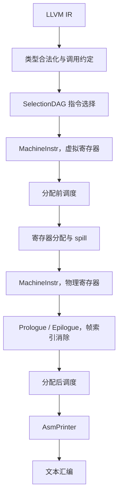
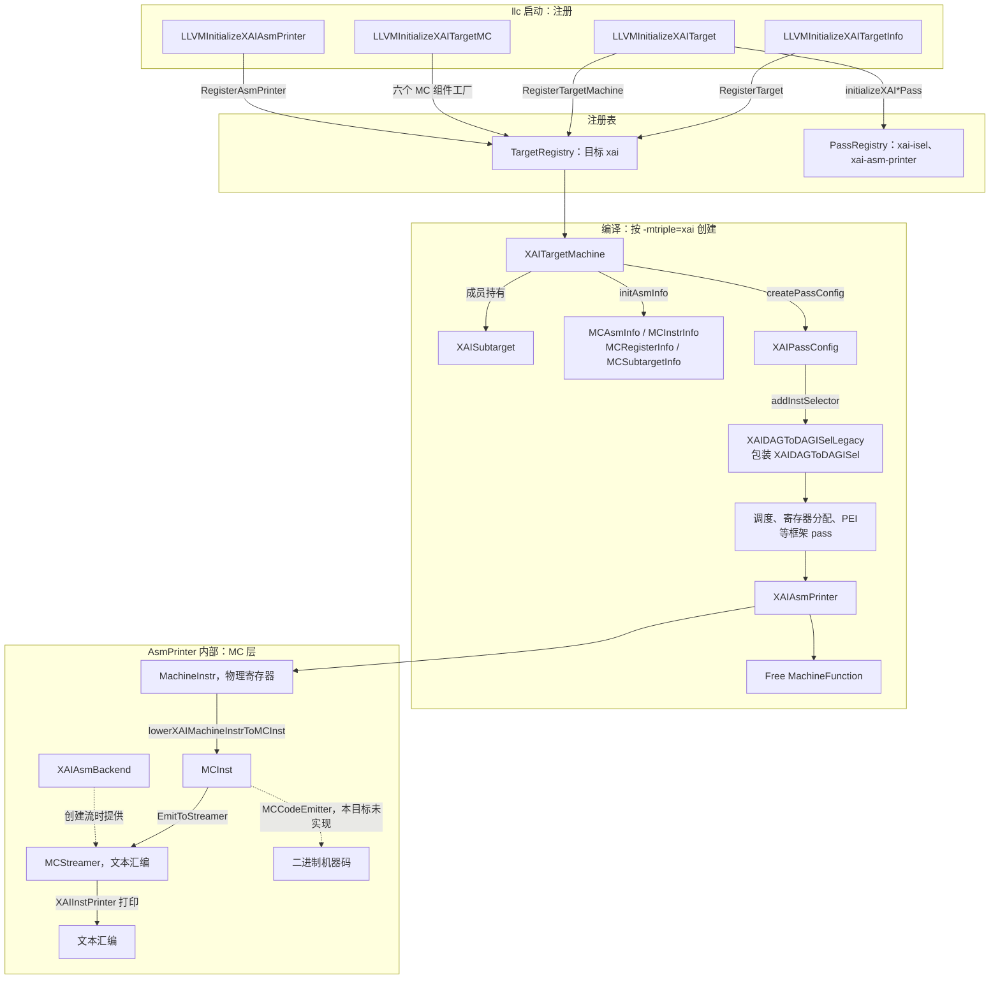

# XAI LLVM 后端 CodeGen

本文描述 XAI 后端如何把 LLVM IR 编成文本汇编。指令语义见 [isa.md](isa.md)。构建命令见 [README.md](../README.md)。

XAI 是教学用目标，架构名 `xai`。LLVM 的 OS 类型里已经占用了 `aix`，因此本目标使用独立的架构枚举 `Triple::xai`。输入是 LLVM IR，输出是文本汇编。没有硬件、模拟器、汇编器或目标文件编码器。

新增源码按 LLVM 树内路径放在仓库的 `llvm/`，由 `patches/0002-add-xai-backend.patch` 打进构建树。setup 只应用 `patches/series`，不另做目录复制。上游提交记在 `patches/llvm-project.rev`。构建树是 `third_party/llvm-project`，没有 `.git`。`llc` 在 `third_party/llvm-project/build/bin/llc`。

## 1. 流水线

XAI 与通用 CPU 后端共用 LLVM CodeGen。LLVM 提供合法化驱动、SelectionDAG 选择框架、BranchFolder、寄存器分配、MachineScheduler、PEI 和汇编流。目标提供这些框架要调用的描述和钩子：寄存器类、合法类型、调用约定、DAG lowering、指令模式、调度模型、分配与栈帧钩子、MC 打印。`Sched::RegPressure` 只影响 SelectionDAG 在指令选择期间的发射顺序，不影响后面的 MachineScheduler。MachineInstr 的调度有两次，用的都是 `XAISchedule.td` 里的顺序发射模型：一次在寄存器分配前，一次在 PEI、分支折叠和伪指令展开之后。PEI 是 LLVM 的 pass，插入的 prologue 和 epilogue 指令来自 `XAIFrameLowering`。下图只画主要阶段，寄存器合并、分支折叠、伪指令展开和块排布没有单独列出。



图里有两份 `MachineInstr`。指令选择出来的用虚拟寄存器；寄存器分配换成物理寄存器。PEI 和分配后调度改的是这份物理寄存器指令，AsmPrinter 打印调度之后的结果。

| 阶段 | LLVM 负责 | 本仓库中的实现 |
|---|---|---|
| 目标注册 | `TargetRegistry`，按 triple 选择 `TargetMachine` | 四个 `LLVMInitializeXAI*` 函数，见 1.1 |
| 类型合法化 | 按合法类型拆分或提升非法类型 | `XAIISelLowering.cpp` 登记 `i64`、`v256f16`、`v256f32` |
| 调用约定 | `CCState` 按 TableGen 规则分配位置 | `XAICallingConv.td` 的 `CC_XAI`，C++ 拒绝栈参数和非 `void` 返回 |
| 指令选择 | SelectionDAG 匹配 `Pat`，Custom 节点调用 `LowerOperation` | `XAIInstrInfo.td`；访存和 `BR_CC` 在 C++ 中完成 |
| 分配前调度 | `MachineScheduler`，`-O0` 不跑 | `XAISchedule.td` 的 `XAIModel`；`enableMachineScheduler` 返回 true |
| 分配后调度 | `PostMachineScheduler`，`-O0` 不跑 | 同一模型；`XAIPassConfig` 用它替换旧的 `PostRAScheduler` |
| 分支折叠 | BranchFolder 调用 `analyzeBranch` 等钩子 | `XAIInstrInfo.cpp` |
| 寄存器分配 | 分配虚拟寄存器，必要时插入 spill | `copyPhysReg`，以及 `xai.st` / `xai.ld`、`xai.mstore.f32` / `xai.mload.f32` |
| 栈帧 | PEI 调用 prologue、epilogue 和帧索引消除 | `XAIFrameLowering.cpp`、`XAIRegisterInfo::eliminateFrameIndex` |
| 汇编打印 | AsmPrinter 把 `MachineInstr` 降成 `MCInst`，送到 MC 流 | `XAIAsmPrinter.cpp`、`XAIMCInstLower.cpp`、`XAIInstPrinter.cpp` |

Data layout：

```
e-m:e-p:64:64-i64:64-i32:32-i16:16-i8:8-f64:64-f32:32-f16:16-n64-S8192
```

小端，ELF 名称修饰，指针 64 位，原生整数宽度 64 位。`S8192` 表示栈按 8192 bit（1024 字节）对齐，与矩阵 spill 槽一致。同一条字符串也写在 `TargetDataLayout.cpp` 的 `xai` 分支里。

`llc -mtriple=xai` 能选中这个后端，依赖四处对上游已有文件的修改，记在 `patches/0001-register-xai-architecture.patch`。上游没有的目标、intrinsic 和测试记在 `patches/0002-add-xai-backend.patch`。允许改动的路径都在 `patches/upstream-files.txt` 里，新增路径以 `+` 开头：

| 位置 | 作用 |
|---|---|
| `Triple.h` / `Triple.cpp` | 架构名 `xai`，64 位指针，小端 |
| `TargetDataLayout.cpp` | 上面的 data layout |
| `llvm/CMakeLists.txt` | `LLVM_ALL_TARGETS` 加入 `XAI` |
| `Intrinsics.td` 与 `include/llvm/IR/CMakeLists.txt` | 包含 `IntrinsicsXAI.td`，生成 `IntrinsicsXAI.h` |

`patches/series` 必须能干净地应用到 `patches/llvm-project.rev`。`scripts/update_llvm_patch.sh` 用干净上游和当前树的差异重写 `0001`，用本仓库的 `llvm/` 重写 `0002`，并拒绝清单以外的源码改动。

`lib/Target/CMakeLists.txt` 按 `LLVM_TARGETS_TO_BUILD` 添加子目录，因此目标目录本身不必再手写 `add_subdirectory`。

### 1.1 目标注册与组件关系

`llc` 启动时依次调用 `InitializeAllTargets()`、`InitializeAllTargetMCs()`、`InitializeAllAsmPrinters()`。其中 `InitializeAllTargets()` 先调用各目标的 `TargetInfo` 初始化函数，再调用 `Target` 初始化函数。对 XAI，这三步一共调用四个函数：

| 函数 | 文件 | 登记到 | 登记内容 | 何时取用 |
|---|---|---|---|---|
| `LLVMInitializeXAITargetInfo` | `TargetInfo/XAITargetInfo.cpp` | `TargetRegistry` | `Target` 对象，名字 `xai`，匹配 `Triple::xai` | `-mtriple=xai` 查找目标 |
| `LLVMInitializeXAITarget` | `XAITargetMachine.cpp` | `TargetRegistry`、`PassRegistry` | `XAITargetMachine` 的工厂；`xai-isel`、`xai-asm-printer` 两个 pass 名 | 创建 `TargetMachine`；`-print-after`、`-stop-after` 等按名字查找 pass |
| `LLVMInitializeXAITargetMC` | `MCTargetDesc/XAIMCTargetDesc.cpp` | `TargetRegistry` | `MCAsmInfo`、`MCInstrInfo`、`MCRegisterInfo`、`MCSubtargetInfo`、`MCInstPrinter`、`MCAsmBackend` 六个工厂 | 前四个由 `XAITargetMachine` 构造时的 `initAsmInfo` 取用；后两个在创建汇编流时取用 |
| `LLVMInitializeXAIAsmPrinter` | `XAIAsmPrinter.cpp` | `TargetRegistry` | `XAIAsmPrinter` 的工厂 | `addPassesToEmitFile` 创建 `AsmPrinter` pass |

两张注册表作用不同。`TargetRegistry` 按目标保存工厂函数，用来创建 `TargetMachine`、MC 组件和 `AsmPrinter`。`PassRegistry` 保存 pass 的 ID、命令行名和构造方式，用来按名字查找 pass。`initializeXAIAsmPrinterPass` 和 `initializeXAIDAGToDAGISelLegacyPass` 由各自 `.cpp` 中的 `INITIALIZE_PASS` 宏生成，只登记名字，不决定 pass 在流水线中的位置。



注册顺序不决定 pass 的先后。一次编译怎么把这些组件串起来，见 1.2。

### 1.2 一次编译的顺序

`llc -mtriple=xai` 按下面的顺序进行。

1. 启动时调用 1.1 的四个函数，把工厂和 pass 名写入注册表。这一步只做一次。
2. 按 triple 创建 `XAITargetMachine`（继承 `CodeGenTargetMachineImpl`）。没有 `-mcpu` 时 CPU 名是 `generic`，没指定时重定位模型是 static、代码模型是 Small。构造函数同时创建成员 `XAISubtarget`，里面有 `XAIInstrInfo`、`XAIFrameLowering`、`XAITargetLowering`，并按这个 CPU 名找到 `XAIModel`。它还创建一个 ELF 的 `TargetLoweringObjectFile`，AsmPrinter 用它决定段怎么写。接着 `initAsmInfo` 从 `TargetRegistry` 取出 `MCRegisterInfo`、`MCInstrInfo`、`MCSubtargetInfo` 和 `MCAsmInfo`。
3. `CodeGenTargetMachineImpl::addPassesToEmitFile` 搭建流水线，分三步，与上面的注册顺序无关：
   - `addPassesToGenerateCode` 调用 `createPassConfig`，得到 `XAIPassConfig`。它的构造函数用 `substitutePass` 把分配后调度从 `PostRAScheduler` 换成 `PostMachineScheduler`。框架按默认序列加 pass；加到指令选择时回调 `addInstSelector`，加入 `createXAIISelDag` 返回的 `XAIDAGToDAGISelLegacy`。
   - `addAsmPrinter` 从 `TargetRegistry` 取出 `XAIAsmPrinter` 的工厂，创建 pass 并加在代码生成 pass 之后。所以它是最后一个生成代码的 pass。
   - 最后加入 `Free MachineFunction`，释放每个函数的 `MachineFunction`。`llc -debug-pass=Structure` 的末尾就是 `XAI Assembly Printer`、`Free MachineFunction`。
4. 对每个函数跑这条流水线。轮到指令选择时，pass 管理器调用 `XAIDAGToDAGISelLegacy`，它把每个 DAG 节点交给内部的 `XAIDAGToDAGISel::Select`。之后的 pass 通过 `MF.getSubtarget()` 取得同一个 `XAISubtarget`，再取出寄存器、指令、栈帧和调度模型。
5. `XAIAsmPrinter` 把每条 `MachineInstr` 降成 `MCInst` 并打印成文本汇编，见 3.6。

`-O0` 不加入两次 MachineInstr 调度，以及分支折叠等后期优化。`-stop-after` 截断流水线时，`addPassesToEmitFile` 改为加入 MIR 打印 pass，不再创建 `AsmPrinter`。

## 2. 寄存器、指令与调用约定

### 2.1 寄存器

| 类 | 寄存器 | 机器类型 | 溢出槽 |
|---|---|---|---|
| `GPR` | `r0`–`r31` | `i64` | 8 字节，对齐 8 字节 |
| `MR` | `m0`–`m7` | `v256f32`、`v256f16` | 1024 字节，对齐 1024 字节 |

`r31` 在 `getReservedRegs` 里保留，分配器不会把它分给虚拟寄存器。它是栈指针。`getFrameRegister` 返回 `r31`。`XAIGenRegisterInfo` 的返回地址寄存器号是 `r30`；本目标没有 call，也没有链接寄存器，`r30` 仍是可分配的 GPR。

`MR` 同时容纳两种 tile。16×16 FP32 是 1024 字节，16×16 FP16 是 512 字节。两种值占用同一组物理寄存器，spill 槽按较大的 1024 字节计算。TableGen 里 alignment 的单位是 bit，所以写成 8192，并设置 `Size = 8192`。

没有被调用者保存寄存器。`getCalleeSavedRegs` 返回空表。

### 2.2 指令

| 汇编 | 机器操作码 | 作用 |
|---|---|---|
| `xai.mma md, ma, mb, mc` | `XAI_MMA` | `md = ma × mb + mc`。`ma`、`mb` 为 FP16 tile，`mc`、`md` 为 FP32 tile |
| `xai.mload.f16 md, imm(rs)` | `XAI_MLOAD_F16` | 从指针读 FP16 tile |
| `xai.mload.f32 md, imm(rs)` | `XAI_MLOAD_F32` | 从指针读 FP32 tile |
| `xai.mstore.f16 imm(rs), ma` | `XAI_MSTORE_F16` | 写 FP16 tile |
| `xai.mstore.f32 imm(rs), ma` | `XAI_MSTORE_F32` | 写 FP32 tile |
| `xai.ld rd, imm(rs)` | `XAI_LD` | GPR load，用于 GPR spill |
| `xai.st imm(rs), rs` | `XAI_ST` | GPR store，用于 GPR spill |
| `xai.mov rd, rs` | `XAI_MOV` | GPR 拷贝 |
| `xai.mmov md, ms` | `XAI_MMOV` | 矩阵寄存器拷贝 |
| `xai.add rd, rs1, rs2` | `XAI_ADD` | 寄存器加 |
| `xai.addi rd, rs, imm` | `XAI_ADDI` | 加有符号 32 位立即数 |
| `xai.li rd, imm` | `XAI_LI` | 物化有符号 32 位常量 |
| `xai.br label` | `XAI_BR` | 无条件跳转 |
| `xai.beq rs1, rs2, label` | `XAI_BEQ` | 相等则跳转 |
| `xai.bne rs1, rs2, label` | `XAI_BNE` | 不等则跳转 |
| `xai.bltu rs1, rs2, label` | `XAI_BLTU` | 无符号小于则跳转 |
| `xai.bgeu rs1, rs2, label` | `XAI_BGEU` | 无符号大于等于则跳转 |
| `xai.ret` | `XAI_RET` | 返回 |

`xai.mma` 是四操作数指令：结果写入 `md`，`mc` 保持原值。寄存器分配可以把 `md` 和某个源操作数合并到同一个物理寄存器，汇编里因此可能出现 `xai.mma m0, m0, m1, m2`。合并发生在分配阶段，指令语义不变。

### 2.3 调用约定

`CC_XAI` 把 `i64` 依次放入 `r0`–`r7`。指针在上述 data layout 下也是 `i64`。第 9 个及以后的 `i64` 在 TableGen 里写成 8 字节栈槽，`LowerFormalArguments` 遇到栈上传参会报错。变参报错。返回值只接受 `void`；非 void 返回报错。

矩阵值不作为参数或返回值。kernel 接收指向 tile 的指针，用 `llvm.xai.mload.*` 装入 `MR`，用 `llvm.xai.mstore.*` 写回。

## 3. 各阶段

### 3.1 LLVM IR 与类型

`IntrinsicsXAI.td` 的 `TargetPrefix` 是 `xai`。记录名 `int_xai_mma` 在 IR 里是 `@llvm.xai.mma`。

| Intrinsic | 参数与结果 | 内存效果 |
|---|---|---|
| `llvm.xai.mload.f16` | `ptr` → `<256 x half>` | 读内存，带 chain |
| `llvm.xai.mload.f32` | `ptr` → `<256 x float>` | 读内存，带 chain |
| `llvm.xai.mstore.f16` | `ptr`，`<256 x half>` | 写内存 |
| `llvm.xai.mstore.f32` | `ptr`，`<256 x float>` | 写内存 |
| `llvm.xai.mma` | 两个 `<256 x half>`、一个 `<256 x float>` → `<256 x float>` | `IntrNoMem` |

`<256 x half>` 对应 `MVT::v256f16`，`<256 x float>` 对应 `MVT::v256f32`。这两种 MVT 来自 LLVM 23 的 `ValueTypes.td`。

`XAITargetLowering` 把 `i64` 放进 `GPR`，把两种 tile 向量放进 `MR`，然后调用 `computeRegisterProperties`。这三种类型因此是合法类型，legalizer 不会把 tile 拆成标量。布尔内容是 `ZeroOrOneBooleanContent`。`TargetLowering` 给出的 `setcc` 结果类型是指针宽度 `i64`。条件分支在构建 DAG 时先产生 `i1` 的 `setcc`，类型合法化再把它提升到 `i64`。

合法类型只表示该值可以放进寄存器。tile 向量的普通 `add`、普通 `load`/`store`，以及 `float` 标量运算，没有选择模式。

### 3.2 参数与返回值

`LowerFormalArguments` 用 `CC_XAI` 分析参数。寄存器参数通过 `addLiveIn` 进入 `GPR`，再 `getCopyFromReg` 交给 DAG。例如三个指针参数成为 `r0`、`r1`、`r2` 的 live-in。

`LowerReturn` 在返回值为空时生成 `XAIISD::RET_FLAG`。该节点带 chain，由 `XAI_RET` 的 pattern 选成 `xai.ret`。

### 3.3 指令选择

`llvm.xai.*` 在合法化阶段保持为通用 intrinsic 节点，不生成 `XAIISD` 节点，也不生成 `MachineInstr`。构建 DAG 时，`IntrNoMem` 的 `llvm.xai.mma` 成为 `ISD::INTRINSIC_WO_CHAIN`，读内存的 `mload` 成为 `ISD::INTRINSIC_W_CHAIN`，写内存的 `mstore` 成为 `ISD::INTRINSIC_VOID`。节点上带的是 intrinsic ID。`v256f16` 和 `v256f32` 已登记为合法类型，合法化不拆开这些节点。`LowerOperation` 只处理 `ISD::BR_CC`。本目标唯一的 target-specific DAG 节点是 `LowerReturn` 生成的 `XAIISD::RET_FLAG`。

选择逻辑和 pass 包装是两个类。`XAIDAGToDAGISel` 继承 `SelectionDAGISel`，只负责选择，不实现 pass 接口。`XAIDAGToDAGISelLegacy` 继承 `SelectionDAGISelLegacy`，是旧 pass 管理器里的 `FunctionPass`：它持有一个 `XAIDAGToDAGISel`，被调用时把工作转过去。LLVM 这样拆，是为了让同一套选择逻辑适配新旧两种 pass 管理器；新 pass 管理器对应的包装是 `SelectionDAGISelPass`。XAI 只写了旧包装，`llc` 默认走这条路径。`createXAIISelDag` 返回的是 `XAIDAGToDAGISelLegacy`。`INITIALIZE_PASS` 登记的名字 `xai-isel` 也属于这个包装类，见 1.1。

`Select` 先处理 tile 访存 intrinsic，其余节点交给 TableGen 生成的 `SelectCode`。`llvm.xai.mma` 由 `XAIInstrInfo.td` 的 `Pat` 选成 `XAI_MMA`。四条访存 intrinsic 带 chain，TableGen 的 `Pat` 匹配不上，由 `selectMemIntrinsic` 在 C++ 里选成对应的 `MachineInstr`。

| DAG | 选择结果 | 实现位置 |
|---|---|---|
| `llvm.xai.mma`（`INTRINSIC_WO_CHAIN`） | `XAI_MMA` | `XAIInstrInfo.td` 的 `Pat` |
| `llvm.xai.mload.f16/f32`（`INTRINSIC_W_CHAIN`） | `XAI_MLOAD_F16/F32`，偏移 0 | `selectMemIntrinsic` |
| `llvm.xai.mstore.f16/f32`（`INTRINSIC_VOID`） | `XAI_MSTORE_F16/F32`，偏移 0 | `selectMemIntrinsic` |
| `add`，两操作数均为 GPR | `XAI_ADD` | `Pat` |
| `add`，一操作数为有符号 32 位立即数 | `XAI_ADDI` | `Pat`，立即数谓词 `XAISimm32` |
| 有符号 32 位常量 | `XAI_LI` | `Pat` |
| `br` | `XAI_BR` | 指令自身的 pattern |
| `brcond` + `setcc` | `XAI_BEQ` / `XAI_BNE` / `XAI_BLTU` / `XAI_BGEU` | `LowerBR_CC` |

带 chain 的 load/store intrinsic 在 TableGen 里带未建模副作用，`Pat` 匹配不上，所以在 C++ 里选择。偏移立即数固定为 0；指针算术在 load 之前用 `xai.add` 或 `xai.addi` 完成。

`getelementptr i8` 在 `shouldPreservePtrArith` 关闭时降成 `ISD::ADD`，与整数加法共用模式。元素大小为 1 的常量偏移，只要落在有符号 32 位以内，就选 `xai.addi`。更大的元素类型会先生成 `shl` 或 `mul`，这两条运算没有选择模式。

条件分支的路径如下。

1. `CondBr` 在 SelectionDAGBuilder 里变成 `SETCC` 与 `BRCOND`，假分支再接一条 `BR`。
2. `ISD::BRCOND` 的动作是 Expand。操作数是 `SETCC` 且比较类型为 `i64` 时，展开为 `ISD::BR_CC`。
3. `ISD::BR_CC` 对 `i64` 是 Custom。`LowerBR_CC` 按条件码生成一条比较跳转。基本块的类型也是 `MVT::Other`，指令发射器只把最后一个 `Other` 操作数当作 chain，所以机器节点的操作数顺序是比较的两端、目标块，最后才是 chain。

| 条件码 | 指令 |
|---|---|
| `SETEQ` | `xai.beq` |
| `SETNE` | `xai.bne` |
| `SETULT` | `xai.bltu` |
| `SETUGE` | `xai.bgeu` |

其他条件码在 `LowerBR_CC` 里报错。后面的形态不是指令选择生成的。PEI 之后、分配后调度之前，BranchFolder 调用 `analyzeBranch`，删掉紧接着跳到下一块的 `xai.br`。分配后调度之后的块排布可能把落在下一块上的分支取反。所以 `icmp ult` 在 `loop.ll` 里变成入口的 `xai.bgeu` 和循环体末尾的 `xai.bltu`。

### 3.4 指令调度

两次调度都读 `XAIModel`，由框架完成依赖图和发射时间的计算。XAI 只提供这张表，并打开两个开关：`enableMachineScheduler` 返回 true；`XAIPassConfig` 用 `substitutePass` 把旧的 `PostRAScheduler` 换成 `PostMachineScheduler`。`-O0` 两者都不跑。

| | 分配前 `MachineScheduler` | 分配后 `PostMachineScheduler` |
|---|---|---|
| 位置 | 寄存器合并之后、分配之前 | PEI、分支折叠和 `ExpandPostRAPseudos` 之后，块排布之前 |
| 看到的寄存器 | 虚拟寄存器 | 已经分配好的物理寄存器 |
| 目标 | 兼顾延迟和寄存器压力。排得太散会让更多值同时存活，增加 spill | 只缩短停顿。寄存器已经定死，不再考虑 spill |
| 额外约束 | 数据依赖和内存依赖 | 同一个物理寄存器被重复使用时，写不能越过尚未读完的旧值 |

`XAIModel` 是顺序、单发射模型（`IssueWidth = 1`，`MicroOpBufferSize = 0`）。`CompleteModel = 1`，所以每条指令，包括 `COPY`，都要有 `InstRW`。延迟是相对代价，不是实测周期：GPR 运算、移动、立即数、GPR 访存和分支是 1，矩阵 load 和 `xai.mma` 是 4，矩阵 store 是 2。

框架建依赖图时，寄存器数据依赖边的延迟等于**生产者**的延迟，也就是结果写完后要过多久才能被读。`xai.mload.f32` 到 `xai.mma` 的边是 4，因为 load 写出矩阵寄存器。`xai.mstore` 不写寄存器，它的 2 不会变成这种边；和其他指令之间只有内存顺序约束，框架给 store 之后的 load 用固定延迟 1。XAI 没有 `ReadAdvance`，也没有自己的调度算法：最早发射周期和选下一条指令都由 `GenericScheduler` 计算。

`sched.ll` 里把地址加法提到 `xai.mma` 前面的是分配后调度。分配前调度只把一个 `COPY` 挪到靠近它的使用者的地方，缩短虚拟寄存器的存活范围。加法与 `xai.mma` 没有数据依赖，而它写入的物理寄存器此时已经没有人再读，所以可以填进 load 的等待空隙。`-O0` 不调度，加法仍留在 store 之后。

本目标不插入 `nop`，也不做冒险识别。调度只改变顺序；硬件被假定会在结果未就绪时自行停顿，所以 `-O0` 的结果仍然正确。

### 3.5 寄存器分配、spill 与栈帧

分配器是 LLVM 自带的。目标提供的是它调用的钩子。

| 钩子 | 行为 |
|---|---|
| `copyPhysReg` | GPR 用 `xai.mov`，MR 用 `xai.mmov` |
| `isCopyInstrImpl` | 识别这两条拷贝，供合并使用 |
| `storeRegToStackSlot` / `loadRegFromStackSlot` | GPR 用 `xai.st` / `xai.ld`；MR 用 `xai.mstore.f32` / `xai.mload.f32` |
| `eliminateFrameIndex` | 见下文 |
| `emitPrologue` / `emitEpilogue` | 栈大小非 0 时用 `xai.addi` 调整 `r31` |

帧向下增长，栈对齐 1024 字节，局部区域偏移为 0，没有 frame pointer，也不能在运行时重新对齐（`StackRealignable=false`）。函数代码的对齐是另一件事：`XAITargetLowering` 用 `setMinFunctionAlignment` 把它设为 4 字节。`setStackPointerRegisterToSaveRestore(r31)` 把 `r31` 交给 PEI。`analyzeBranch`、`insertBranch` 和 `removeBranch` 由 BranchFolder 调用，见 3.3，不属于分配器。

栈帧大小由 PEI 的 `calculateFrameObjectOffsets` 计算，`emitPrologue` 和 `emitEpilogue` 只读取结果。它以进入函数时的 SP 为原点，按每个栈对象自己的大小和对齐往后排；对齐取整多出来的字节就是空隙，最后再按 1024 字节向上取整，得到 `StackSize`。这两个函数在 `StackSize` 为 0 时不插指令，否则分别插入 `xai.addi r31, r31, -StackSize` 和返回前的相反调整。入口 SP 按 1024 对齐是 ABI 假设，所以对象离原点的距离按它对齐，就等于地址按它对齐，不需要 frame pointer。

溢出槽的大小和对齐来自寄存器类，不是来自上面的栈对齐值。`GPR` 是 8 字节、8 对齐，`MR` 是 1024 字节、1024 对齐。两种槽排在一起时，各自按自己的对齐取整。因为栈不能重新对齐，对象要求的对齐超过 1024 时会被截到 1024；XAI 把栈对齐设成 1024，就是为了让矩阵槽不被截小。XAI 的栈帧目前只有溢出槽和这些对齐填充：没有 `alloca`，栈上传参会报错，也没有被调用者保存寄存器。

spill 槽在分配期间是帧索引。`eliminateFrameIndex` 在 prologue 已经插入之后，把该操作数改成 `r31`，并把下一条立即数设为：

```
objectOffset + stackSize + 原立即数 + SPAdj
```

向下增长时，对象偏移为负，加上栈大小后成为相对调整后的 `r31` 的非负位移。epilogue 插在第一个 terminator 之前。

`mma.ll` 的矩阵值个数不超过 8，汇编里没有栈调整。`spill.ll` 把 9 个 MMA 结果放进循环 phi，使它们在回边上同时存活。单条指令最多读三个矩阵寄存器，活值个数仍然超过 `m0`–`m7`，因此至少有一个 MR 进入 1024 字节栈槽。汇编形态见 4.3。FP16 tile 若被 spill，使用的仍是 FP32 宽度的 `xai.mstore.f32` / `xai.mload.f32`。`xai.li` 标了 `isReMaterializable` 和 `isAsCheapAsAMove`，有符号 32 位常量在寄存器不够时可以重新物化。

### 3.6 MC 与汇编打印

`XAIAsmPrinter` 是最后一个生成代码的 pass，位置见 1.2。它把每条 `MachineInstr` 降成 `MCInst`，再交给 MC 层输出。`MCInst` 既不是汇编文本，也不是二进制机器码，而是这两种输出共同的输入。MC 组件从哪里注册，见 1.1。

| 表示 | 所在层 | 内容 |
|---|---|---|
| `MachineInstr` | CodeGen | 操作码、显式与隐式操作数、`killed` / `dead` 等寄存器标记、所属基本块、内存操作数 |
| `MCInst` | MC | 操作码和显式操作数。操作数只有寄存器、立即数、表达式三类 |
| 文本汇编 | 输出 | `XAIInstPrinter` 按 TableGen 的汇编字符串打印 `MCInst` |
| 二进制机器码 | 输出 | `MCCodeEmitter` 把 `MCInst` 编码成字节；本目标未实现 |

`XAIAsmPrinter::emitInstruction` 跳过 `KILL`、`DBG_VALUE` 这类 meta 指令，调用 `lowerXAIMachineInstrToMCInst`，再 `EmitToStreamer`。`lowerXAIMachineInstrToMCInst` 是 `AsmPrinter` 内部调用的函数，不是单独的 pass。它按下面的规则转换：

1. 操作码原样复制。`MachineInstr` 与 `MCInst` 共用 TableGen 生成的 `XAI::XAI_*` 枚举。
2. 只转换显式操作数，即 `.td` 里 `outs` / `ins` 列出的操作数。隐式操作数不进汇编，直接丢弃。
3. 寄存器只保留物理寄存器号，丢掉 `killed`、`dead`、`renamable` 等标记。立即数原样复制。基本块换成指向该块 `MCSymbol` 的 `MCSymbolRefExpr`；标号地址要等汇编器排好指令后才确定，所以写成表达式而不是数值。
4. 其他操作数类型报错。帧索引在 PEI 中已由 `eliminateFrameIndex` 换成 `r31` 加偏移，不应出现在这里；全局地址等类型本目标不支持。

`-print-before=xai-asm-printer` 打印降级前的 `MachineInstr`，`-asm-show-inst` 在汇编旁注释出对应的 `MCInst`。`mma.ll` 和 `loop.ll` 中的两条指令如下：

| 阶段 | `mma.ll` 中的乘加 | `loop.ll` 中的回边分支 |
|---|---|---|
| `MachineInstr` | `$m0 = XAI_MMA killed $m0, killed $m1, killed $m2` | `XAI_BLTU $r5, $r3, %bb.2` |
| `MCInst` | `XAI_MMA`：`Reg:M0`、`Reg:M0`、`Reg:M1`、`Reg:M2` | `XAI_BLTU`：`Reg:R5`、`Reg:R3`、`Expr:LBB0_2` |
| 文本汇编 | `xai.mma m0, m0, m1, m2` | `xai.bltu r5, r3, LBB0_2` |

打印时，`XAIInstPrinter` 调用 TableGen 生成的 `printInstruction`，格式来自 `XAIInstrInfo.td` 的汇编字符串，例如 `xai.mma $dst, $a, $b, $acc`。`printOperand` 打印三类操作数：寄存器名由 `getRegisterName` 查 `XAIRegisterInfo.td` 得到，立即数打印成十进制，表达式由 `MCAsmInfo::printExpr` 打印成 `LBB0_2` 这样的标号。

文本汇编的流在创建时需要 `MCAsmBackend`。`XAIAsmBackend` 是小端实现：`applyFixup` 不写修复，`writeNopData` 写 0。`createObjectTargetWriter` 返回一个 ELF writer，重定位类型在 `getRelocType` 里报错。没有注册 `MCCodeEmitter`，因此 `llc -filetype=obj` 在创建编码器时失败。

## 4. 三条编译结果

FileCheck 约束助记符和栈访问形态。除 spill 测试里的 `r31` 外，物理寄存器号由分配器决定，下面的编号是当前 `llc` 的一次输出。

### 4.1 直线性 MMA

`llvm/test/CodeGen/XAI/mma.ll` 把三个指针上的 tile 装入矩阵寄存器，做一次乘加，再把 FP32 结果写回第三个指针。

```
kernel:
	xai.mload.f16 m0, 0(r0)
	xai.mload.f16 m1, 0(r1)
	xai.mload.f32 m2, 0(r2)
	xai.mma m0, m0, m1, m2
	xai.mstore.f32 0(r2), m0
	xai.ret
```

这条函数的栈大小为 0，没有 prologue。`m0` 同时出现在目的和 `ma` 上，是寄存器合并的结果。

### 4.2 计数循环

`loop.ll` 的参数是三个 tile 指针、无符号上界 `n` 和步长 `step`。循环变量从 0 开始，每个迭代用 `getelementptr i8` 把 A、B 指针前进 512 字节，把 C 指针前进 1024 字节，再用寄存器步长更新下标。

```
loop:
	xai.li r5, 0
	xai.bgeu r5, r3, LBB0_3
LBB0_2:
	xai.mload.f16 m0, 0(r0)
	xai.mload.f16 m1, 0(r1)
	xai.mload.f32 m2, 0(r2)
	xai.mma m0, m0, m1, m2
	xai.mstore.f32 0(r2), m0
	xai.add r5, r5, r4
	xai.addi r2, r2, 1024
	xai.addi r1, r1, 512
	xai.addi r0, r0, 512
	xai.bltu r5, r3, LBB0_2
LBB0_3:
	xai.ret
```

`r5` 是下标，初值由 `xai.li` 写成 0；`r3` 是上界 `n`，`r4` 是步长。`xai.add` 把步长加进下标，`xai.addi` 做指针步进。入口的 `xai.bgeu` 在下标已经不小于上界时直接跳到 `xai.ret`。循环体末尾的 `xai.bltu` 只在更新后的下标仍小于上界时回到 `LBB0_2`；条件不成立时不跳转，顺序落到紧接着的 `xai.ret`。跳到紧邻下一块的 `xai.br` 已被删掉。

### 4.3 矩阵寄存器 spill

`spill.ll` 计算 9 个相互依赖的 MMA 结果，并把它们作为循环 phi 传入循环体。循环体按迭代变化的地址逐个 store。9 个 `MR` 活值同时存在，物理寄存器只有 8 个。

汇编中的栈形态是：

```
xai.addi r31, r31, -2048
xai.mstore.f32 1024(r31), m1
xai.mload.f32 m1, 1024(r31)
xai.addi r31, r31, 2048
xai.ret
```

`-2048` 表示两个 1024 字节槽。具体 spill 个数和偏移随分配结果变化；测试要求的是对 `r31` 的负向调整、`xai.mstore.f32` / `xai.mload.f32` 访问 `(r31)`，以及返回前的正向调整。

## 5. 文件索引

| 文件 | CodeGen 职责 |
|---|---|
| `llvm/include/llvm/IR/IntrinsicsXAI.td` | intrinsic 名称、类型、内存效果 |
| `llvm/lib/Target/XAI/XAI.td` | 目标、汇编打印、`generic` 处理器 |
| `XAIRegisterInfo.td` | GPR、MR、编码与 DWARF 号 |
| `XAICallingConv.td` | `CC_XAI` |
| `XAIInstrInfo.td` | 指令、`Pat`、分支操作数 `brtarget` |
| `XAISchedule.td` | `XAIModel`：发射宽度、延迟、`InstRW` |
| `XAITargetMachine.cpp` | data layout、pass config、`XAITargetMachine` 注册 |
| `XAISubtarget.h` | 指令、栈帧、lowering 和 `XAIModel` 的集合；`enableMachineScheduler` 打开分配前调度 |
| `XAIISelLowering.cpp` | 合法类型、参数、返回、`BR_CC` |
| `XAIISelDAGToDAG.cpp` | 选择逻辑 `XAIDAGToDAGISel`，以及 pass 包装 `XAIDAGToDAGISelLegacy` |
| `XAIInstrInfo.cpp` | 拷贝、spill、reload、分支折叠 |
| `XAIRegisterInfo.cpp` | 保留寄存器、帧索引消除 |
| `XAIFrameLowering.cpp` | `r31` 的 prologue / epilogue |
| `XAIAsmPrinter.cpp` | 跳过 meta 指令，把 `MachineInstr` 降成 `MCInst` 并送入流 |
| `XAIMCInstLower.cpp` | 寄存器、立即数、基本块到 `MCInst` |
| `MCTargetDesc/XAIInstPrinter.cpp` | 汇编文本 |
| `MCTargetDesc/XAIMCTargetDesc.cpp` | 注册 MC 组件；无 `MCCodeEmitter` |
| `MCTargetDesc/XAIAsmBackend.cpp` | 供文本汇编使用的空后端 |
| `TargetInfo/XAITargetInfo.cpp` | `RegisterTarget<Triple::xai>` |
| `llvm/test/CodeGen/XAI/*.ll` | `llc -mtriple=xai -verify-machineinstrs` |

TableGen 生成 `XAIGenDAGISel.inc`、`XAIGenInstrInfo.inc`、`XAIGenRegisterInfo.inc`、`XAIGenCallingConv.inc`、`XAIGenAsmWriter.inc`、`XAIGenSubtargetInfo.inc`。CMake 不生成汇编匹配器、反汇编器或指令编码器。

## 6. 支持范围

下列 IR 可以通过本后端，并在 `-verify-machineinstrs` 下得到文本汇编：

- `void` 函数，参数是不超过 8 个的 `ptr` 或 `i64`
- 五条 `llvm.xai.*` intrinsic
- `i64` 的 `add`，以及有符号 32 位立即数加法和常量
- GPR spill 使用的 `xai.ld` / `xai.st`。现有测试只迫使矩阵寄存器 spill
- `getelementptr i8` 的常量字节偏移，偏移落在有符号 32 位以内
- `icmp eq`、`icmp ne`、`icmp ult` 与对应的条件分支，以及无条件 `br`

下列输入会在编译期失败：

| 输入 | 失败点 |
|---|---|
| 超过 8 个 `i64`/`ptr` 参数、变参、非 `void` 返回 | `LowerFormalArguments` / `LowerReturn` 报错 |
| 有符号比较，以及其他未列出的条件码 | `LowerBR_CC` 报错 |
| `call`、`select`、乘、除、移位 | 指令选择无法选择 |
| tile 的普通算术、普通 load/store | 指令选择无法选择 |
| 超出有符号 32 位的整数常量 | `xai.li` / `xai.addi` 的模式不匹配 |
| `llc -filetype=obj` | 缺少 `MCCodeEmitter` |

没有旧式指令行程（itinerary）。调度信息在 `XAISchedule.td` 的 `SchedMachineModel` 里，见 3.4。后端也不包含汇编解析器、反汇编器、GlobalISel、Clang builtin、MLIR dialect，以及执行汇编或与参考 GEMM 对数值的运行时。
